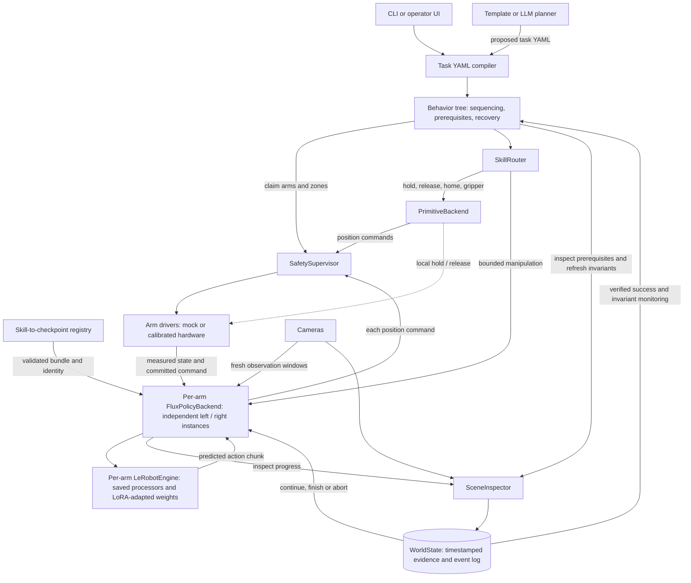

# Architecture

## Core idea

The hard part is not moving objects. It's one arm **changing or maintaining a
condition** so the other arm can do something otherwise impossible. Three
collaboration patterns:

| Pattern | Example | Hackathon scope |
|---------|---------|-----------------|
| Simultaneous: A maintains a condition while B works | hold lid open → insert block | **yes** (Demo A, `lid_hold_insert`) |
| Sequential: A prepares the scene, then B acts | push cup aside → pick block | **yes** (Demo B, `clear_obstacle_pick`) |
| Coordinated: both arms manipulate one object | carry a tray together | design for it, not built |

## Layers

The arrows distinguish policy outputs from motor writes: predicted actions return
to the bounded executor, and every policy position command passes through the
supervisor. Primitive hold/release operations use the driver's local hold contract.
See [the showcase runtime](showcase-runtime.md) for the configured runtime and
validation limits.

| Module | Owns | Key file |
|--------|------|----------|
| Planner | *what* has to happen | `orchestration/planner.py`, `bimanual/obstacle.py` |
| Behavior tree | *when*, in what order, under what conditions | `orchestration/bt.py` |
| World state | *what is true now*, what already happened | `perception/world_state.py` |
| Safety | *is this physically allowed* | `safety/supervisor.py` |
| Skill backends | *how* an arm moves | `policy/`, `orchestration/skills.py` |
| Arms / sim | joint I/O and position hold | `hardware/`, `sim/` |

## Dependencies → nodes

| Dependency | Meaning | Node |
|-----------|---------|------|
| AFTER | A finishes before B starts | `sequence: [A, B]` |
| WHILE | A must remain true during B | `while: {arm, maintain, do: B}` |
| UNTIL | A continues until a condition | `while: {..., until: cond}` / `wait: cond` |

`While` semantics (the bit a plain action list cannot express):

1. claim the support arm and switch it to the **local position-hold controller**
   (no VLA inference needed to keep holding)
2. wait for `maintain` to become true (bounded by `establish_timeout_s`)
3. run the body and monitor `maintain` concurrently. If it breaks, **cancel the body
   and fail** so an enclosing `retry` / `fallback` recovers
4. on body success require `until`. The hold stays on until an explicit `release`

## FLUX 3 Action integration

FLUX is a learned manipulation backend for bounded skills. It's not the coordinator.

- The selected dual-arm profiles use two independent FLUX instances. Each has its
  own execution and inference locks, checkpoint state and history; inference can
  overlap across arms when the tree allows it. Local holding needs no VLA calls.
- Each skill selects a complete checkpoint bundle through configuration. Pinned
  hashes, processor provenance, shared-base identity and driver coordinate contracts
  are checked before motion. LoRA weights are merged during export.
- Measured state, committed commands and camera images form fresh per-target
  history windows. Model and processor state reset at skill boundaries.
- The saved preprocessor, `Flux3Policy.predict_action_chunk` and saved postprocessor
  produce absolute position chunks. Every executed action uses
  `SafetySupervisor.send()`; perception determines whether the skill succeeded.
- Task LoRA retains the existing 6-D action head. The initial unified XLeRobot
  12-D embodiment fine-tune was superseded. Group execution remains covered by
  compatibility mocks; a real 12-D bundle is not validated. Shared-model execution
  remains an explicit serialized fallback, not the selected dual-arm profile.
- The showcase profile uses eight observations, 42 predicted actions, and up to
  16 executed actions per window at 30 Hz. Hardware timing, model quality and
  loaded-gripper reliability remain deployment validation items.

## Safety model

- **Ownership:** one node commands an arm at a time. A conflict is a bug and aborts the run with an e-stop.
- **Zones:** skills declare shared zones (`zones: [box]`). Only one *moving* arm per zone.
  A holding arm doesn't take the lock, so plan holds to stay clear of the other arm's path.
- **Limits:** clip to joint limits and max per-step delta; reject NaN/inf.
- **E-stop:** CLI Ctrl-C, `POST /estop`, any `ArmConflict`/`EmergencyStop`.
  The SO101 emergency path disables torque; a normal skill stop parks the arm
  while preserving the gripper's existing closing goal. These are distinct operations.
- **Force:** SO-101 + FLUX give joint *position* targets, not torque. Holding is
  position holding, so use light lids and low-force contacts. Torque-regulated tasks
  (e.g. unscrewing caps) are out of scope.

## Memory

`WorldState` holds symbolic facts plus an append-only JSONL event log (facts with
source, node start/end, retries, WHILE violations). Subgoal markers (`set:`) and
`fallback: [check: done, ...]` let a long task skip work that's already done after a
restart or replan. An LLM can read the log for replanning, but correctness is enforced
by the tree and predicates.

## Simulation's role

Use simulation for **orchestration** (trees, synchronisation, zones, failure
injection, reset logic) via the same `Arm` API. Don't assume a policy trained on real
images transfers zero-shot to rendered images. `MockBackend` + `Fault` already covers a
lot of failure testing with no physics at all.
