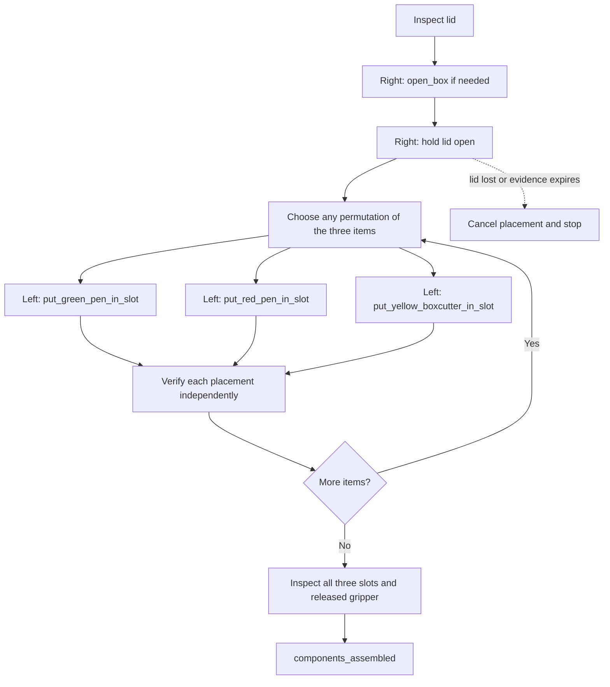
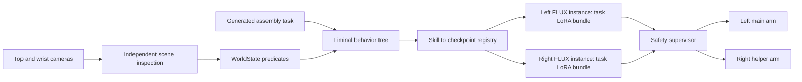

# Box assembly runtime

The initial plan was to fine-tune a unified bimanual XLeRobot embodiment (12-D actions). That plan
was superseded by task LoRA fine-tuning of the existing 6-D SO-101 policy, with two independent FLUX
instances, one per arm, coordinated by the real skill-runtime harness (behavior tree, checkpoint
registry, perception and safety).

This guide describes the configured runtime, not a completed dual-arm hardware
validation. GPU memory and concurrent inference latency must be measured on the host.
Both instances default to `cuda`; set `devices: {left: "cuda:0", right: "cuda:1"}`
in the policy profile when using two GPUs.

The current task is `configs/tasks/assemble_components.yaml`: the right helper arm
opens and holds the box, and the left main arm places the green pen, red pen and
yellow boxcutter into their respective slots. Cable manipulation is excluded.
The earlier replacement task is archived under `configs/tasks/archive/`.



The model receives these exact task prompts:

| Skill | Prompt |
|---|---|
| `open_box` | `open the box by pulling its handle` |
| `put_green_pen_in_slot` | `put the green pen in the green slot` |
| `put_yellow_boxcutter_in_slot` | `put the yellow cutter in the yellow slot` |
| `put_red_pen_in_slot` | `put the red pen in its slot in the cardboard box` |

The orchestrator manages lid holding and placement order separately from these prompts.

The three placement skills run sequentially because they share the left arm.
They have no dependency on one another. Fresh inspection skips items already
seated. The lid must remain open throughout placement; failed verification stops
the task. There is no automatic retry or untrained recovery movement. The helper
is stopped at its holding pose on exit; this task does not close the box or home arms.

## Choose the order

```bash
python scripts/build_component_task.py \
  --order yellow_boxcutter red_pen green_pen \
  --output configs/tasks/assemble_components.yaml
liminal validate configs/tasks/assemble_components.yaml
```

All six permutations are supported. Regenerate the task to change order:
`placement_order` is descriptive metadata, while the generated tree determines execution.

## Checkpoints and execution

Use `configs/policy/showcase_registry.yaml` with
`configs/perception/component_assembly.yaml` and a calibrated robot/camera profile.
The red-pen skill maps to the pinned Oskrt bundle described in
[the checkpoint guide](pen-checkpoint.md), now targeting physical `left`.
Opening, green-pen and yellow-boxcutter entries are **unstaged templates** with zero
hashes. They must be replaced with independently validated trained bundles and
matching contracts. The full learned task cannot run with these placeholders.
Their expected contracts are proposals marked VERIFY, not claims about existing weights.

Each prediction has 42 actions; execute **16** before observing again. The profile
selects `instances: per_arm`: left and right have independent FLUX model sessions,
so inference can overlap when the tree permits it. Within each arm, checkpoint
changes occur between skills and reset model/processor state and observation history.
LoRA adapters are merged into the skill bundles; no new bimanual action head is trained.
Each model serializes its own execution, not the other arm's execution. Every command passes through
the safety supervisor; arm ownership and the lid invariant remain enforced by
Liminal's behavior tree.



The orchestrator and learned inference currently run in the same process on a
host that can access the GPU, cameras and arms. This runtime does not add an RPC
transport to the remote inference VM. The former MuJoCo assembly sequence driver
has been removed. Training runs separately in the GPU training environment; it produces
bundles for the registry, never orchestrator decisions.

## Reproduce motor-free validation

```bash
PYTHONPATH=src python scripts/showcase_runtime.py --output outputs/assembly
pytest -q tests/test_component_assembly.py
```

The demo runs all six orders through the real BT and FLUX executor using synthetic
checkpoint files, deterministic actions and independent symbolic scene feedback.
It validates orchestration and checkpoint switching, not learned grasp quality,
MuJoCo physics, or hardware behavior. See [recorded results](validation/showcase-results.json).
