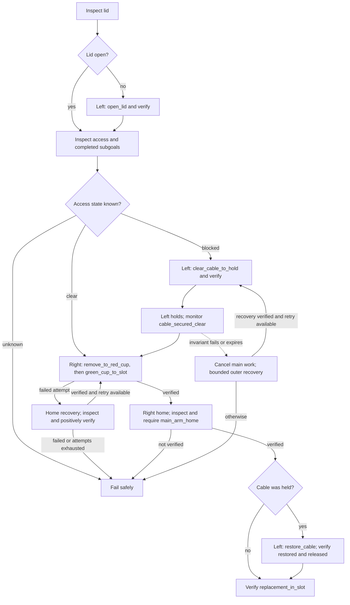

# Component replacement runtime

The showcase uses `configs/tasks/replace_component.yaml` and
`configs/policy/showcase_registry.yaml`. Liminal owns sequencing, exclusive arm
ownership, prerequisites, fresh success evidence and bounded recovery. FLUX owns
only bounded manipulation windows. There is one execution path:

`task → SkillNode → FluxPolicyBackend → LeRobotEngine → saved processors → SafetySupervisor`

The motor-free SSH worker also imports `LeRobotEngine`. The older standalone live
commands remain reproduction tools for earlier experiments; they are not the
showcase coordinator. Do not run a live runner alongside the behavior tree.

## Runtime and checkpoint boundary

The [architecture overview](architecture.md#layers) shows ownership, motor commands
and perception feedback. This sequence shows what happens when a skill selects a
different checkpoint; the same bundle still resets state at a new skill boundary.

```mermaid
sequenceDiagram
    participant BT as SkillNode
    participant S as SafetySupervisor
    participant F as FluxPolicyBackend
    participant R as Checkpoint registry
    participant E as LeRobotEngine
    participant A as Arm driver
    participant I as SceneInspector / WorldState
    BT->>S: Claim target arms and workspace zones
    BT->>F: Execute bounded skill
    F->>F: Acquire execution lock; check quarantine
    F->>A: Freeze target; preserve gripper goal
    F->>R: Resolve skill; validate driver contract, provenance and hash
    alt Bundle cannot be loaded or validated
        F-->>BT: Failure; no policy motion
    else Compatible bundle loaded
        F->>E: Load saved weights and processors; reset
        F->>I: Inspect success and active invariants
        loop Until verified success or bounded failure
            A-->>F: Fresh measured and committed-command history
            Note over F,E: Camera frames join the per-target history window
            F->>E: Predict action chunk
            E-->>F: Absolute position targets
            F->>F: Reject stale observation or expired invariant evidence
            F->>S: Send each bounded action
            S->>A: Validated, limited position command
            F->>A: Freeze before inspection
            F->>I: Inspect outcome and invariants
            I-->>F: Fresh true, false or unknown evidence
        end
        F-->>BT: Skill result
        BT->>I: Independently verify fresh success evidence
    end
    BT->>A: Stop while ownership remains held
    BT->>S: Release ownership and zones
```

During a `While` body, an independent perception task refreshes the support
invariant even while weights load or inference runs. A separate expiry monitor
cancels the body if evidence expires or the invariant fails. Cancellation during
loading or inference quarantines the backend; another skill cannot reuse it.

## Showcase task flow



This diagram summarizes the task YAML: already verified removal or installation
subgoals can be skipped. Opening, cable clearing and restoration also have bounded
retries with verified home recovery. The helper retains its local hold through
main-arm work and home verification.

## Atomic skills

| Skill | Target | Verified outcome |
|---|---|---|
| `open_lid` | left | `lid_open` |
| `clear_cable_to_hold` | left | `cable_secured_clear` |
| `remove_to_red_cup` | right | `faulty_component_in_red_cup` |
| `green_cup_to_slot` | right | `replacement_in_slot` |
| `restore_cable` | left | `cable_restored`, followed by released-cable inspection |

These match `integrate/harness-main` at `6975d2f`. The tree chooses clear versus
obstructed access from inspection. On the obstructed route the helper holds while
the main arm removes and replaces the component. The main arm must be positively
verified home before the cable is restored. Recovery homes are inspected and
checked; failed recovery ends the retry. Each manipulation is attempted at most
twice. A skill's 240-second deadline includes its cold load, inference, inspection
and motion; loading has an additional 180-second cap.

## Run the demonstrations

From the repository root, use Python 3.12:

```bash
python -m venv .venv
.venv/bin/pip install -e '.[dev]'
.venv/bin/python scripts/showcase_runtime.py --output outputs/showcase
.venv/bin/liminal validate configs/tasks/*.yaml
.venv/bin/python -m pytest
.venv/bin/ruff check src tests scripts
```

The demonstration runs clear access, blocked access and a failed-placement recovery.
Each directory contains `events.jsonl` and `summary.json`, including atomic-skill
calls, actual mock command counts and checkpoint identities. It exercises the real
BT, registry validation, FLUX execution loop and safety supervisor. The plant,
perception and model are **symbolic simulations**: checkpoint payloads are synthetic
and outcomes follow deterministic simulated transitions. These demonstrations do
not establish contact physics, learned-policy quality, VLM accuracy or hardware
readiness. They do not use the unfinished dual-arm MuJoCo scene.

## Stage real checkpoints

The supplied registry is a deployment template. Its missing paths and zero hashes
intentionally fail before policy motion. No trained replacement-skill weights are
included in this repository. Prepare a complete local LeRobot export for each
skill, including weights, saved pre/post processors and offline encoder assets.
Merge LoRA weights during export; runtime adapter mutation is not supported.

Use an immutable identifier for the shared midtraining base, including its revision.
The training/export pipeline must supply `liminal_provenance.json` in each bundle.
It contains the registry entry's `base`, `embodiment`, `joint_order`, `state_units`,
`action_semantics`, `action_dim`, `camera_roles`, `targets`, `obs_history`,
`chunk_size`, `control_hz` and `normalization_profile`. Arrays preserve order.
Do not include `path` or `sha256`. This sidecar records the pipeline's lineage
assertion; runtime checks cannot reconstruct training ancestry from weights.

For the shipped profile, state/actions use the SO101 joint order shown in YAML,
five joint angles in degrees and gripper position in percent, with absolute position
actions. A left-only checkpoint is refused on the right arm. Both-arm policies must
provide a separate compatible profile with 12 ordered joint names, the appropriate
camera roles, group target and matching saved action head; 12-D mock execution is
tested, but no bimanual learned checkpoint is supplied or validated here.

```bash
python scripts/check_checkpoint_registry.py --hash-bundle /liminal/models/skills/open_lid
# Put that digest and the resolved bundle path in the registry. Repeat for each bundle.
python scripts/check_checkpoint_registry.py configs/policy/showcase_registry.yaml
python scripts/flux_smoke_test.py --policy configs/policy/showcase_registry.yaml --skill open_lid --iters 3
```

The digest covers every file, including provenance and processors. Keep the staged
bundle read-only while running. New compatible skills require a registry entry and
skill mapping, plus their normal catalog/task configuration; no Python dispatch
change is needed. Smoke testing loads real weights and runs dummy observations
without motors. It is an API/output-contract check, not a task-success evaluation.

## GPU and robot setup

Install this repository into the same GPU Python environment as the official
LeRobot FLUX integration. The previously recorded LeRobot revision is
`e624f3f7f8411ec3a02635d06e79373341e5ef35`; dependency and offline-cache details are
in [official-inference.md](official-inference.md). The new engine uses that worker's
`Flux3Policy`, saved processors and explicit measured/commanded observation history.
VERIFY the installed revision's feature metadata and processor contract by running
the smoke test against every deployed bundle. `pip install -e .` alone does not
install FLUX, torch, VLMs or hardware drivers.

The showcase runs model inference and orchestration in one process. Arrange GPU
access on the controller host; it does not automatically reuse the older remote
live-runner transport. The legacy worker now also requires this package installed
in its GPU environment, instead of copying only the worker script.

Configure measured home poses, calibrated joint limits, real camera devices and
wrist/scene mappings in a local robot profile. The `so101` driver implements the
BT freeze/hold contract; the standalone `official_so101` driver's torque-release
stop must not be substituted. With validated hardware and checkpoint profiles:

```bash
liminal run configs/tasks/replace_component.yaml \
  --robot /path/to/calibrated_robot.yaml --backend flux \
  --policy configs/policy/showcase_registry.yaml \
  --perception configs/perception/qwen3_vl_4b.yaml --engage
```

This is an explicit motor-engagement command, not part of the automated validation.
Evaluate the configured VLM and predicate definitions on the actual scene first.

## Boundaries and evidence

One shared execution lock covers loading, reset, inference and the entire skill.
A switch freezes the target while its BT ownership remains held, invalidates the
old engine, verifies provenance/hash/compatibility, loads processors and weights,
resets state, and gathers a new observation window before motion. Load failures
never fall back to the previous checkpoint. Cancellation or timeout during a worker
thread quarantines the backend because Python cannot safely kill that thread.
Restart the backend before resuming; a queued skill cannot bypass quarantine.

Histories contain measured state and the committed command after supervisor and
SO101 driver limiting. They are sampled at the configured period into new windows
after pauses, rather than reusing frames from a preceding skill. Normal stops
invalidate cached command targets. Observation age is checked after inference;
invariants are checked before every send. `While` refreshes invariant perception
independently while loading/inference runs, and a separate expiry monitor cancels
motion if evidence stops arriving. Adjust latency budgets only from measured data.
Camera reads currently use the driver's host read time, not a hardware exposure
timestamp; camera buffering/synchronization remains a hardware validation item.

Normal SO101 stops retain the gripper's existing closing goal while parking the
other joints. E-stop still disables torque. Fake-bus tests verify the intended
writes; loaded-gripper force retention has **not** been validated on hardware.
Likewise, passing mock tests does not establish actual checkpoint load latency,
GPU memory fit, 12-D learned inference, visual accuracy or component replacement.
