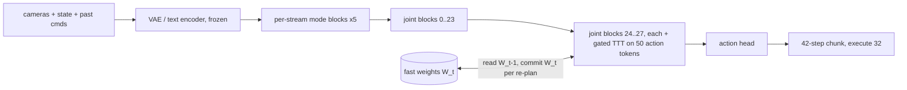
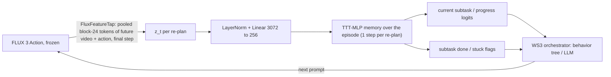
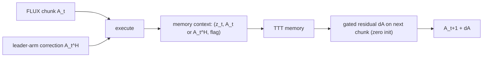

# RoboTTT downstream of FLUX 3 Action: digest, fit, pipelines, go/no-go

WS4 research note, 2026-10-17. Owner of this file and of `ws4/ttt/**`: the ws4-ttt agent.

## Status report

**Done**
- Read the full RoboTTT paper (arXiv 2607.15275v1, all 22 pages incl. appendices A and B) and the TTT
  lineage (Sun et al. 2024, LaCT, TTT-E2E, Nested Learning, Gated DeltaNet). Digest with equations in Sec. 1-2.
- Checked code/weights: no official RoboTTT code or weights anywhere (Sec. 1.10).
- Read flux-action@830f1ce (transformer, wiring, packing, history, policy, sampling, inference DiT); token
  layout and hook points with `file:line` in Sec. 3.
- Built `ws4/ttt/`: TTT layer (linear and MLP fast weights, KVB inner loss, mini-batch inner updates,
  learnable `W0` and inner learning rate, tanh gate), a temporal block wrapper, TBPTT / sequence action
  forcing / loss-masking helpers, `flux_hook.py` (a sidecar adapter that hooks into flux-action's real
  `JointSingleSeq`), `progress_memory.py` (pipeline P2), two toy experiments and 30 CPU tests (all pass,
  `ruff` clean).

**Verified (run, not just read)**
- Analytic inner gradients equal autograd; a linear fast-weight memory stores and recalls associations
  exactly; streaming equals one pass; causality; gate 0 is exactly the identity and the paper's 1e-3 gate is
  identity up to a 1e-3-scaled term; TBPTT carries fast-weight values but cuts gradients; `W0` still learns.
- On a tiny CPU instance of flux-action's **own** `JointSingleSeq` code: the hook changes only the action
  streams, gate 0 leaves FLUX bit-identical, memory advances only on `commit()`, and **flux-action's packed
  multi-window training call gives the same outputs as window-by-window streaming inference with commits**,
  i.e. FLUX's existing training packer already is RoboTTT-style sequence training. Gradients reach only the
  adapter when FLUX is frozen.
- Two toy experiments (Sec. 6): in-context recall over gaps up to 1024 steps, and P2-style subtask tracking
  over aliased repeated stages, where TTT beats a GRU at long horizons (0.95 vs 0.47) but not at short ones
  (0.80 vs 1.00).

**Not verified**
- Anything with real FLUX weights, GPU throughput or latency, real robot data. Compute numbers in Sec. 7 are
  estimates (`UNVERIFIED`). RoboTTT details the paper does not state are marked `UNVERIFIED` in Sec. 1.9.

**Next 3 steps**
1. Decide go/no-go for pipeline P2 at the 18:00 check (Sec. 8 gates): FLUX inference running on the cloud
   GPU, at least 30 recorded multi-stage episodes with subtask labels, and WS3 wanting a progress signal.
2. If go: run `FluxFeatureTap` over the recorded episodes on the GPU (one pass, no backward), train the small
   episode memory on CPU, wire its stage output into the WS3 orchestrator as an advisory signal.
3. Either way: put the toy and the verified FLUX integration in the slides as the "long-context memory"
   research track; keep P1 (in-trunk RoboTTT) for after the hackathon (Sec. 9).

---

## 0. Bottom line

- **RoboTTT is real and the idea is sound**, but its gains come from a big long-context *pretraining* run
  (16 GB200, 30K steps, a long-trajectory robot + egocentric-human corpus) followed by 5 to 8 hours of task data
  per task. Its own scaling curve says that below about 1K pretraining timesteps it does not beat a
  short-context baseline. We have none of that, and no official code or weights.
- **Structurally FLUX 3 Action is a clean fit**: gated TTT layers after FLUX's joint blocks, on the 50
  action-stream tokens, one inner step per re-plan. Verified at tiny scale on flux-action's own DiT code.
  Inference cost is negligible and constant in episode length.
- **In-trunk RoboTTT on FLUX before Sunday 14:00 on real hardware: no-go.** Data (long multi-stage episodes)
  and training time are the blockers, not the code.
- **Hackathon-sized variant worth doing if three gates pass**: P2, a small TTT memory *downstream* of a
  frozen FLUX that reads one FLUX feature per re-plan over the whole episode and outputs task progress /
  current subtask for the orchestrator. No motor authority, cheap to train, uses FLUX's internal "imagination"
  features. Otherwise present the TTT work as a research track with the toy and the verified integration.

---

## 1. RoboTTT digest (arXiv 2607.15275v1, NVIDIA GEAR + Stanford + UT Austin, 16 Jul 2026)

Sources: https://arxiv.org/abs/2607.15275 (full text read, pages 1-22), project page
https://research.nvidia.com/labs/gear/robottt/.

### 1.1 TTT-KVB layer (paper Sec. 2, App. A.1)

Tokens `X`, projections `Q_t = θ_Q x_t`, `K_t = θ_K x_t`, `V_t = θ_V x_t`, fast model `f_W` (two-layer MLP
with GELU in RoboTTT). "Update then apply" at every inner step:

$$W_t = W_{t-1} - \eta \, \nabla_W \mathcal{L}_{FW}\big(f_{W_{t-1}}(K_t),\, V_t\big), \qquad
\mathcal{L}_{FW}(\hat v, v) = \lVert \hat v - v \rVert^2 \qquad (1)$$

$$O_t = f_{W_t}(Q_t) \qquad (2)$$

The loss binds keys to values ("key-value binding", KVB, the name Tandon et al. 2025 use for this family).
`θ_Q, θ_K, θ_V` and `W_0` are slow weights trained by the outer loss; `W_0` is meta-learned "through gradients
of gradients". Inner learning rate: learned on top of a constant base rate 0.1 (App. A.1, following Sun et
al.). Positional encoding RoPE with θ = 10000 (App. A.1). Fast model: two-layer GELU MLP updated by plain
gradient descent (Muon left to future work).

### 1.2 Where the layers sit in GR00T N1.7 (Sec. 3.1, Fig. 2-3, App. A.1)

- GR00T N1.7 = Eagle VLM + a 16-layer DiT action head (538M params). One TTT layer is added to **each** of the
  16 DiT layers, **after the self- and cross-attention**: attention works within one timestep, the TTT layer
  works across timesteps. About 10M params per TTT layer, 690M total.
- DiT input over a trajectory: `[R_1, Φ_1, q_1, Ã_1, ..., R_T, Φ_T, q_T, Ã_T]`, with `Φ_t` the VLM tokens,
  `q_t` the proprioception token, `Ã_t` the noised action tokens, `R_t` N = 16 learned register tokens per
  timestep. Attention runs on `R_t, q_t, Ã_t` and cross-attends to `Φ_t` of the same timestep. The
  per-timestep outputs are concatenated over time and go through the TTT layer. **`Φ` never enters the TTT
  layer** (cost); the registers carry visual information across time.
- Fig. 2 labels the fast-weight sequence `W_0, W_1, ..., W_{T/H}` with mini-batches `1 ... T/H` for timesteps
  `t = 1, 1+H, ..., T`, and "one mini batch per inference": **one inner update per action-chunk inference**,
  context counted in control timesteps (8K timesteps ≈ 4.5 min at 30 Hz). Reading of the figure, the text does
  not spell it out.

### 1.3 Near-zero tanh gate (Sec. 3.1, Eq. 3)

Initialized from the pretrained GR00T weights. Per DiT layer a learned `α ∈ R^d`, initialized to 0.001:

$$O = \tanh(\alpha) \odot O_{TTT} + O_{attn} \qquad (3)$$

So the network starts as the pretrained policy plus a 1e-3-scaled TTT term (Flamingo-style gating).

### 1.4 Sequence training, sequence action forcing (Sec. 3.2, Eq. 4-5)

Each training sequence is a full trajectory or a contiguous sub-trajectory up to the max context. TTT runs
over it in the inner loop; the outer flow-matching loss is averaged over all timesteps:

$$\mathcal{L}_{fm}(\xi; W_0) = \frac{1}{T}\sum_{t=1}^{T} \mathbb{E}_{\tau_t,\epsilon}
\Big[\big\lVert v_\theta(\Phi_t, A_t^{\tau_t}, q_t; W_{t-1}) - (A_t - \epsilon)\big\rVert^2\Big],
\quad A_t^{\tau} = \tau A_t + (1-\tau)\epsilon \qquad (5)$$

**Sequence action forcing**: the noise level `τ_t` is drawn **independently for each action chunk**,
`τ_t = s(1-u)`, `u ~ Beta(1.5, 1)`, `s = 0.999`. One shared level per sequence ("full-sequence diffusion")
made training unstable; without it closed-loop performance drops significantly (Fig. 12: "inaccurate motions
leave the robot unable to make meaningful progress").

### 1.5 Truncated BPTT (Sec. 3.2, Fig. 4)

The sequence is cut into segments; gradients flow only inside a segment; the fast weights are carried across
segment boundaries with their gradient detached, so TTT still runs over the whole sequence and memory depends
on the segment length only. `W_0` still gets gradients through the first segment. Segment length: not given.

### 1.6 Inference (Sec. 3.2)

Start each rollout from `W_0`, update the fast weights on the current observation, propagate them to the next
timestep; chunks are generated with k-step denoising. Deployed on a YAM bimanual robot, four RealSense D405
cameras (480p), RTX 5090, 30 Hz (App. A.3). Inference cost is constant in context length (fixed-size state).

### 1.7 Loss masking (Sec. 3.3)

Masking the flow-matching loss on chosen timesteps makes them pure context: they update the fast weights
but are not imitation targets.
- **In-context video imitation**: a human video of the task (robot idle) followed by a robot trajectory of
  the same configuration, loss masked on the video part. Same prompt "assemble circuit" for every
  configuration, so the target is only identifiable from the video. 5 to 20 human videos per training
  configuration.
- **DAgger Distillation**: in a DAgger rollout, all executed chunks (the robot's mistakes and the human
  corrections) update the fast weights, the loss is computed only on the human corrections. "Failures as
  context, corrections as targets"; framed as Algorithm Distillation for robots.

### 1.8 Data, compute, results, ablations

| Item | Value (paper) |
|---|---|
| Pretraining data | tabletop bimanual robot data + egocentric human data (EgoScale), "curated to emphasize long trajectories": <512: 3.1%, 512-1K: 12.5%, 1-2K: 25.9%, 2-4K: 41.4%, >4K: 17.1% (Fig. A.1, timesteps) |
| Pretraining | only the new layers (TTT or GDN) train, GR00T frozen; context grown gradually to the target; 30K steps; 16 GB200; batch 4/GPU (global 64) up to 4K context, 1/GPU (global 16) above; AdamW wd 1e-5; WSD schedule, peak LR 2e-5 |
| Post-training | all params; 1K context; 20K steps; 8 GB200 per task; batch 1/GPU; cosine, peak 5e-5 |
| Task data | 8 h (Pup Go Car, 2 min episodes), 6 h (Circuit, 1 min, 80 configs, train on 20), 5 h (Gear Bot, 5 min, 10 stages) |
| Eval | 20 trials (10 for Gear Bot and one-shot Circuit), rubric score in [0, 1] |

Results:

| | RoboTTT | GR00T N1.7 | GR00T N1.7 Hist. | GDN |
|---|---|---|---|---|
| Avg task completion (3 tasks) | **79%** | 42% | n/a | 56% |
| Full successes Pup Go Car / Circuit / Gear Bot | **9/20, 13/20, 2/10** | 3/20, 3/20, 0/10 | 0/20, 8/20, 0/10 | 3/20, 8/20, 0/10 |
| One-shot imitation from one human video (Circuit, unseen configs) | **65%, 6/10** | n/a | n/a | 33%, 0/10 |
| Perturbation recovery roof / tire | **15/20**, 18/20 | 10/20, 11/20 | 3/20, 5/20 | 13/20, 18/20 |
| Pretraining context 8K vs 1K | 71.5% vs 43.9% (+63%) | | 45.6% (best short ctx) | no trend |
| DAgger Distillation vs before | +36% | | | +29% |

Ablations (Fig. 12, Pup Go Car): removing sequence action forcing hurts significantly; TTT-Linear is 27% worse than the MLP
fast model (still above GR00T); passing action tokens through TTT +23% relative over state tokens only;
registers +18% more; registers alone do not help GR00T. Standard DAgger (corrections only) +9% on average,
fine-tuning on full DAgger trajectories as targets gives nothing extra (57% both): the failed actions are only
useful as context.

**What drives the gains** (my reading): (1) long-context pretraining on long trajectories; context length is
the scaling axis and RoboTTT only overtakes short-context baselines from 1K timesteps on; (2) an expressive,
gradient-updated fast model (MLP > linear > GDN), with `W_0` and update dynamics meta-learned; (3) feeding
past *actions* (and registers) into the memory; (4) training tricks that make long sequences trainable
(sequence action forcing, TBPTT); (5) loss masking that turns demos and failures into context. Naive history
concatenation hurts (GR00T Hist. 39.5% vs 57% on Pup Go Car): causal confusion.

### 1.9 Not stated in the paper (`UNVERIFIED` until code appears)

GR00T N1.7 chunk length `H`; exactly which tokens' update is propagated at inference when denoising takes k
passes (the Fig. 2 legend shows "noised action", "denoised action" and "token w/ masked loss", which suggests
a pass over the denoised chunk whose loss is masked, not confirmed); TBPTT segment length; number of TTT heads
and fast-model width; whether RoPE is applied to the TTT queries/keys over time or only in attention; curriculum
schedule; the exact inner-learning-rate parameterization.

### 1.10 Code and weights

- Project page links only the paper (acknowledgments thank two people "for help with the release", without a
  link). Hugging Face paper page: `githubRepo: null`. GitHub search in NVlabs, NVIDIA, NVIDIA-Omniverse: nothing.
- Unofficial: `lucidrains/robo_ttt` (MIT, last push 2026-09-17) and `Bala-la-la/lerobot-pi0-ttt` (Apache-2.0,
  "LeRobot PI0 with RoboTTT fast weights and TBPTT", 2026-07-19). Not reviewed, not used here.

## 2. TTT lineage (what each piece contributes)

| Paper | Inner model / loss | Update | What RoboTTT takes |
|---|---|---|---|
| Sun et al. 2024, arXiv 2407.04620 ("Learning to (Learn at Test Time)") | linear or 2-layer MLP (4x, GELU), `f(x) = x + LN(f_res(x))`; `ℓ = ‖f(θ_K x) − θ_V x‖²`, output `f(θ_Q x; W_t)` | mini-batch GD, gradient taken at the last `W` of the previous mini-batch, `b = 16`; dual form; learnable `W_0` and `η` | the layer, KVB loss, learnable `W_0`, base rate 0.1 for MLP. Table 1 there: mini-batch TTT and LN+residual in `f` are the biggest wins; linear TTT with batch GD = linear attention |
| LaCT, arXiv 2505.23884 ("Test-time training done right") | SwiGLU MLP, loss `−f(k)ᵀv`, per-token `η_i` | chunks of 2K to 1M tokens; L2 weight norm; optional Muon; window attention inside chunks | large-chunk updates are what make RoboTTT's "one timestep per mini-batch" cheap; nonlinear state > linear; `W_0` std `1/√fan_in` |
| TTT-E2E, arXiv 2512.23675 | the network's own MLPs (last 1/4 of blocks), next-token loss at the network output | mini-batch `b = 1K` with sliding-window attention `k = 8K ≥ b` | meta-learned init through gradients of gradients; shows KVB is not required, scales like full attention with constant latency |
| Nested Learning / Hope, arXiv 2512.24695 | self-modifying Titans + continuum memory system (MLPs updated at several frequencies) | delta-gradient-descent | cited as the broader family; not used |
| Gated DeltaNet, arXiv 2412.06464 | linear matrix state | `S_t = S_{t−1} α_t (I − β_t k_t k_tᵀ) + β_t v_t k_tᵀ` (no test-time GD) | the GDN baseline: same placement and gating, worse with long context |

Open implementations (exist, checked via the GitHub API today): `test-time-training/ttt-lm-pytorch` (MIT),
`a1600012888/LaCT` (MIT), `fla-org/flash-linear-attention` (MIT, has Gated DeltaNet), `test-time-training/e2e`
(JAX), `NVlabs/GatedDeltaNet`. Our prototype re-implements the layer (about 200 lines) instead of importing any.

## 3. FLUX 3 Action from source (flux-action@830f1ce, `ws4/.cache/flux-action`)

### 3.1 Token groups of one SO-101 window

`configs/so101/train.json`: `inference_profile="history"`, `n_obs_steps=8`, `history_snapshots=2`,
`condition_on_past_actions=true`, `chunk_size=42`, `n_action_steps=32`, `fps=30`, canvas 256x512
(latent 8x16), `text_fixed_length=320`, `action_modality="action"`, `separate_timesteps=true`.

| Group (BFL's name) | Stream | Built at | Tokens |
|---|---|---|---|
| task | `ctx` (Qwen3-VL features, 20480-d in, `transformer.py:146`) | `policy._context` | 320 |
| history | `x_video_cond`: 2 snapshot latents | `processing/history.py:82-106, 169-183` | 2 x 128 = 256 |
| state (+ past actions) | `x_action_cond`: 8 ticks, each `[normalized past command delta | normalized state]`, times `(i−7)/fps` | `history.py:120-154` | 8 |
| future | `x_video`: noised future latents | `history.py:169-183`, `policy.py:792-807` | 11 x 128 = 1408 |
| action | `x_action`: noised action chunk | `history.py:137-154` | 42 |

Total about 2034 tokens per window (`processing/packing.py:575-587` gives the DROID budget).

### 3.2 DiT

`JointSingleSeq` (`models/transformer.py:553`), defaults `transformer.py:145-157`: hidden 3072, 24 heads,
`depth=5` per-stream `ModeBlock`s (`content_mode_blocks[m]`, `txt_mode_blocks`, `625-653`), 28 joint
`SingleStreamBlock`s (`655-665`). Each block is a *parallel* block: attention and gated MLP are computed from
the same modulated input and summed before one gated residual (`transformer.py:519-550`). Forward
(`720-906`): stream bookkeeping in `self.sequence` order (`748-756`), per-stream mode blocks (`844-849`),
content concatenated (`851`), joint blocks over `[ctx | content]` (`856-866`) or, with `seqlens`, over each
packed window separately in window-major order (`867-880`), per-stream final layers (`899`).
The action branch is a shared, co-trained trunk routed to each embodiment's modality name
(`models/wiring.py:14-31, 118-143`); fresh embodiment heads start with zeroed output layers (`146-169`).

### 3.3 Memory and cadence

- FLUX's whole context is 8 ticks of state/commands (0.27 s at 30 Hz) and 2 snapshots, plus the prompt.
  `select_action` keeps an `ObservationHistory(n_obs_steps)` deque (`history.py:29-66`) and re-plans only when
  the 32-step queue is empty (`policy.py:1060-1077`). Re-plans are otherwise independent: the aliasing problem
  RoboTTT targets (same-looking stages, "did I already do this?").
- Each re-plan runs the sampler (`policy.py:786-879`): every solver step calls the DiT once, or twice with
  guidance (`inference/sampling.py:40-63`, unconditional first, conditional last).
- The optimized `BF16InferenceDiT` is DROID-only (`policy.py:55-66`, `transformer_inf_bf16.py:32-46`); SO-101
  and custom embodiments run the reference `JointSingleSeq`, which is what the hook targets.
- RTC/async inference is not implemented (`policy.py:1017-1018, 1067-1068`).

### 3.4 Training path

`policy.forward` (`policy.py:631-697`): windows of a micro-batch are packed into one sequence with attention
confined to each window (`packing.py:478-511`, `policy.py:675-680`); timesteps are drawn per window
(`policy.py:662-665`, `packing.py:397-410`: logit-logistic + rational shift 42; `x_t = t·ε + (1−t)·x_0`, so
`t = 1` is noise, opposite to GR00T's `τ`); `flow_loss` supports a per-window `action_mask` (`519-572`).
flux-action itself fine-tunes fully (FSDP, `training/trainer.py`); LoRA lives in the LeRobot integration.

## 4. Can RoboTTT be applied to FLUX 3 Action?

### 4.1 Where the TTT layers go

| Option | Where | Pro | Con |
|---|---|---|---|
| **A1 (recommended)** | after joint blocks `i ∈ S` (`single_blocks`, `transformer.py:856-866 / 877-879`) on `x_action` + `x_action_cond` tokens (50) | the action tokens there have attended to text, observation and the imagined future; matches RoboTTT (TTT on action + state tokens after attention, VL tokens excluded); cheap (50 of 2034 tokens) | FLUX blocks are parallel attention+MLP, so "after attention" becomes "after the block" |
| A2 | after the action-stream `ModeBlock`s (`content_mode_blocks["action"]`, `844-849`) | earliest point, only action tokens | these blocks see only the action stream (no vision/text), so the memory would store action-only history |
| A3 | all 28 joint blocks (literal RoboTTT) | closest to the paper | 28 adapters, backward through the whole trunk |
| B | separate memory module writing extra `x_action_cond` tokens (a "memory token" stream) | FLUX code untouched, memory outside | FLUX has never seen such tokens: needs a fine-tune to use them |
| C | downstream of frozen FLUX (P2/P3 below) | no FLUX training at all | memory cannot change FLUX's actions, only advise the orchestrator or add a residual |

Learned registers (RoboTTT's `R_t`, +18% in their ablation) would be extra tokens in `x_action_cond` or a new
stream; both need fine-tuning. `ws4/ttt/flux_hook.py` implements A1 (any subset of blocks, so also A3).

### 4.2 Sequence unit

One window = one re-plan = one inner mini-batch (50 tokens). At 32 executed ticks per re-plan, a 2-minute
episode is 112 inner steps and a 5-minute one about 280, the same order as RoboTTT's per-chunk updates
(`UNVERIFIED`, depends on their `H`). Control steps are the wrong unit: FLUX produces nothing between
re-plans, and per-tick updates would need 32x more DiT calls.

### 4.3 Inference semantics

Every DiT call of a re-plan reads the committed `W_{t−1}` and stages `W_t`; after sampling, `commit()` keeps
the state from the last call (conditional pass of the final solver step). The memory step therefore sees the
nearly denoised chunk, a noise level that sequence action forcing covers in training. The extra cost is a few
small matmuls on 50 tokens per hooked block per call: negligible next to 2034-token attention and constant in
episode length (no KV cache growth). The memory holds per-episode state: `reset()` between episodes, and the
policy's own `reset()` should call it.

### 4.4 Training

- **Sequence data loader**: windows of one episode at a stride of `n_action_steps` (32 ticks), in time order;
  one micro-batch of W windows = one TBPTT segment. flux-action's packer then gives exactly RoboTTT's layout
  (per-window attention, TTT across windows) and its per-window timestep draw *is* sequence action forcing
  (verified equal to streaming in `test_packed_sequence_training_equals_streaming_inference`).
- **TBPTT**: `adapter.commit()` after each segment's backward.
- **Stage 1 like RoboTTT pretraining**: FLUX frozen, only the adapter trains (FLUX blocks below the lowest
  hooked block can run under `no_grad`). Stage 2: LoRA on FLUX (LeRobot path) or full fine-tune.
- **Loss masking**: zero the `action_mask` rows of context-only windows (`packing.py:519-572`); note the
  per-window mean still counts them in the denominator.
- **EE50 vs joint head (Simone's plan)**: orthogonal. The adapter works on the action-stream tokens whatever
  the head (6-D, 12-D or EE50).

### 4.5 Data needed

Long, multi-stage episodes of the target embodiment where history matters (repeated similar stages,
occlusions, re-tries), ideally minutes long, plus DAgger-style corrections for the recovery behaviour.
RoboTTT used 5 to 8 hours per task *after* long-context pretraining on a large corpus. Our plan has 50 to 100
short demos (WS1) and no long-context pretraining; open long-horizon bimanual datasets are ws4-datasets'
question.

## 5. Candidate pipelines

### P1. In-trunk RoboTTT-FLUX (faithful)

Feasibility before Sunday: low (data, training, hardware validation). Demo value: high if it worked
(long-task recovery, "remembers what it did"). Judging: top on technical difficulty and FLUX use.

### P2. Episode memory sidecar for the orchestrator (FLUX frozen)

What it adds: the orchestrator gets a progress estimate that remembers the whole episode (which objects are
done, how many retries), computed from FLUX's own internal representation of what it sees and imagines. It
cannot move the arms, so it cannot make the robot less safe. Training: one GPU pass over recorded episodes to
cache `z_t` (no backward through FLUX), then minutes on CPU. Labels: subtask ids per re-plan (from WS3's task
decomposition, annotated by time or keyframes). Honest caveats, from the synthetic check in Sec. 6.3: with
short episodes a GRU does as well or better (3 repeated objects: GRU 1.00, TTT 0.80); TTT pulls ahead as the
episode gets longer (8 repeated objects, up to about 190 re-plans: TTT 0.95, GRU 0.47). A 2-minute demo is about
110 re-plans, in between. With only tens of real episodes any learned memory is data-starved, and a
hand-written counter in the orchestrator over perception checks may be the more robust choice; P2 then serves
as an advisory cross-check and a logged research result.

### P3. Correction-conditioned adaptation (DAgger Distillation, light)

Loss only on corrected windows, all windows as context. Needs on the order of 100 DAgger episodes in
RoboTTT; a residual on joint targets also needs the safety clamps. Not feasible by Sunday; a safer light form
is to use the corrections as context for P2's "stuck" flag.

### Alternative (owned by ws4-imagine)

World-model-guided test-time compute: sample several FLUX chunks, score their imagined futures, execute the
best. Complementary: it spends compute per re-plan, TTT carries information across re-plans.

### Ranking

| Pipeline | Feasible by Sun 14:00 | Demo value | Tech difficulty (20%) | Use of FLUX (20%) | Risk to the live demo | Verdict |
|---|---|---|---|---|---|---|
| P2 sidecar | medium (needs FLUX on GPU + 30 labelled episodes) | medium | high | high (uses FLUX's internal imagination features) | none (advisory) | **do if gates pass** |
| P3 light (stuck flag from corrections) | low-medium | medium | high | medium | none | add-on to P2 |
| P1 in-trunk | very low | high | very high | very high | high | post-hackathon |
| P3 residual | very low | medium | high | medium | high (motor authority) | no |

## 6. Prototype and toy results (`ws4/ttt/`)

TOY_RESULTS_PLACEHOLDER

## 7. Compute and data budget (`UNVERIFIED` estimates)

Per window, the DiT runs 5 mode blocks + 28 joint blocks of about 123M params each on about 2034 tokens:
about 2 x 4.05e9 x 2034 ≈ 1.6e13 FLOPs forward, plus about 1.4e12 for attention. RTX PRO 6000 Blackwell:
about 500 TFLOPS dense BF16 (third-party spec sheets list 1000 sparse; NVIDIA's dense figure not found,
`UNVERIFIED`); assume 40% utilization.

| Job | Cost |
|---|---|
| Inference, one re-plan (4 steps x 2 CFG passes) | ≈ 1.4e14 FLOPs ≈ 0.7 s at 40% utilization; the TTT adapter adds < 1% |
| P2: cache `z_t` for 100 episodes x 60 re-plans | 6000 re-plans, inference only: about 1 GPU-hour or less across 3 GPUs (plus VAE/text encoding) |
| P2: train the memory (256-d, 1 TTT layer) | minutes on CPU |
| P1 stage 1 (FLUX frozen, adapters on last 4 joint blocks, 16-window segments) | forward ≈ 1.75e13 per window plus activation-only backward through 4 blocks ≈ 2e12, so ≈ 3e14 FLOPs per segment ≈ 2 s; 100 two-minute episodes ≈ 700 segments ≈ 23 min per epoch on one GPU, ≈ 8 min on 3; 20 epochs ≈ 2.5-3 h (future-video VAE latents precomputed once) |
| P1 with adapters in all 28 blocks | backward through the whole joint stack: about 3x the above |
| Memory | bf16 DiT ≈ 14 GB + encoders; adapters ≈ 2 x 3072 x 512 + small per block (inner 512): fits one 96 GB GPU |
| Data for P1 | hours of long multi-stage episodes on the target robot; RoboTTT: 5-8 h per task after pretraining |

## 8. Go / no-go for the hackathon

**P1 (in-trunk): no-go.** Code is ready to hook in, but there is no long-episode dataset, no time for a
multi-hour training run plus hardware validation, and RoboTTT's own evidence says the benefit needs
long-context pretraining we cannot do.

**P2 (sidecar): conditional go at the 18:00 check** if all three hold:
1. FLUX 3 Action inference runs on a cloud GPU with our checkpoint (WS1);
2. at least 30 recorded episodes of the demo task with 3+ subtasks (WS1/WS5 recordings, labels from WS3's
   decomposition), so that a learned memory is not hopelessly data-starved;
3. WS3 wants a progress/subtask signal and can treat it as advisory (the tree still checks success with
   perception).

Otherwise: no-go, and the TTT work goes into the slides as a research track (toy results, the verified
integration with flux-action, the post-hackathon plan). Feature freeze at hour 24 applies.

## 9. Post-hackathon plan

1. Collect long multi-stage episodes on XLeRobot (2-5 min, repeated stages, perturbations) plus DAgger
   corrections with the leader arms; 5+ hours.
2. Stage 1: P1 with FLUX frozen, adapters on the last 4-8 joint blocks, 16-window TBPTT segments, context
   curriculum up to the episode length; evaluate against FLUX alone and against FLUX + a frame-stack memory.
3. Add registers as extra `x_action_cond` tokens; try A3 (all blocks); LoRA on the trunk.
4. DAgger Distillation with loss-masked robot windows; one-shot imitation from a human video context.
5. If the in-trunk path works, move the hook into flux-action's prepared inference DiT (one call site,
   `transformer_inf_bf16.py:689-690`) and upstream a clean `memory` interface.

## 10. Sources

- RoboTTT: https://arxiv.org/abs/2607.15275 (v1), https://research.nvidia.com/labs/gear/robottt/,
  https://huggingface.co/papers/2607.15275 (no repo linked).
- Sun et al. 2024: https://arxiv.org/abs/2407.04620. LaCT: https://arxiv.org/abs/2505.23884.
  TTT-E2E: https://arxiv.org/abs/2512.23675. Nested Learning: https://arxiv.org/abs/2512.24695.
  Gated DeltaNet: https://arxiv.org/abs/2412.06464.
- Code: https://github.com/black-forest-labs/flux-action @ 830f1ce178d7aea52f18fde31d8e8e36ce6bae21;
  https://github.com/test-time-training/ttt-lm-pytorch; https://github.com/a1600012888/LaCT;
  https://github.com/fla-org/flash-linear-attention; https://github.com/test-time-training/e2e;
  https://github.com/lucidrains/robo_ttt; https://github.com/Bala-la-la/lerobot-pi0-ttt.
- GPU spec (third-party, unofficial): https://flopper.io/gpu/nvidia-rtx-pro-6000-blackwell-server-edition.
