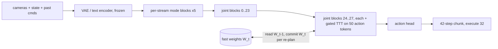
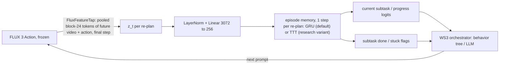
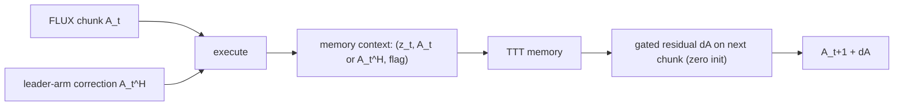

# RoboTTT downstream of FLUX 3 Action: digest, fit, pipelines, go/no-go

WS4 research note, 2026-10-17. Owner of this file and of `ws4/ttt/**`: the ws4-ttt agent.

## Status report

**Done**
- Read the full RoboTTT paper (arXiv 2607.15275v1, all 22 pages incl. appendices A and B) and the TTT
  lineage (Sun et al. 2024, LaCT, TTT-E2E, Nested Learning, Gated DeltaNet). Digest with equations in Sec. 1-2.
- Checked code/weights: no official RoboTTT code or weights anywhere (Sec. 1.10).
- Read flux-action@830f1ce (transformer, wiring, packing, history, policy, sampling, inference DiT); token
  layout and hook points with `file:line` in Sec. 3.
- Built `ws4/ttt/`: TTT layer (linear and MLP fast weights, KVB inner loss, mini-batch inner updates,
  learnable `W0` and inner learning rate, tanh gate), a temporal block wrapper, TBPTT / sequence action
  forcing / loss-masking helpers, `flux_hook.py` (a sidecar adapter that hooks into flux-action's real
  `JointSingleSeq`), `progress_memory.py` (pipeline P2), two toy experiments and 30 CPU tests (all pass,
  `ruff` clean).

**Verified (run, not just read)**
- Analytic inner gradients equal autograd; a linear fast-weight memory stores and recalls associations
  exactly; streaming equals one pass; causality; gate 0 is exactly the identity and the paper's 1e-3 gate is
  identity up to a 1e-3-scaled term; TBPTT carries fast-weight values but cuts gradients; `W0` still learns.
- On a tiny CPU instance of flux-action's **own** `JointSingleSeq` code: the hook changes only the action
  streams, gate 0 leaves FLUX bit-identical, memory advances only on `commit()`, and **flux-action's packed
  multi-window training call gives the same outputs as window-by-window streaming inference with commits**,
  i.e. FLUX's existing training packer already is RoboTTT-style sequence training. Gradients reach only the
  adapter when FLUX is frozen.
- Toy 1 (Sec. 6.2): a TTT-linear memory trained from scratch recalls in-context pairs perfectly at trained
  gaps and at 0.87 for 16x longer gaps (memory-less and 8-step-history baselines: chance). Wrapped around a
  pretrained memory-less policy with the 1e-3 gate, outputs at initialization match the base (100% same
  arg-max), but learning to use the memory is slow (0.28 after 800 steps).
- Toy 2 (Sec. 6.3, P2): tracking the subtask over aliased repeated stages needs a memory (no memory: capped at
  1/objects), but a GRU does it as well or better than the TTT memory at these horizons (up to about 190
  re-plans; 3 seeds: GRU 0.94 to 1.00, TTT 0.74 to 1.00). No evidence that TTT helps at hackathon scale.

**P2 build (17 Oct afternoon, Sec. 11)**: shared label format, 208 labelled sim episodes of the demo skills,
CPU features, training/evaluation against no-memory, last-k and GRU baselines, `ProgressMonitor` API for the
orchestrator, the GPU feature-extraction script and runbook, the 7B gate-0 / latency check script, and a Claude
vision stage labeller (0.78 to 0.83 agreement with sim ground truth, about $0.02 per episode). On
held-out sim episodes the memory lifts stage accuracy on repeated stages from 0.38 (no memory) and 0.48
(last 4 re-plans) to 0.999 (GRU) and 0.93 (TTT); the GRU is the shipped default.

**Pod run (17 Oct, 13:32 to 14:06 UTC, Sec. 11.9)**: on the real 7B FLUX 3 Action, gate 0 is bit-identical, the
adapter adds 32 ms (+4.2%) and 0.07 GiB; FLUX features were extracted at 0.82 s per re-plan; with the same
12 training episodes, FLUX features beat frame features (stage 0.87 to 0.90 vs 0.72 to 0.75 with memory).
Serving was restored and verified, then the idle watchdog stopped the pod as designed.

**Not verified**
- Anything with real FLUX weights, GPU throughput or latency, real robot data. Compute numbers in Sec. 7 are
  estimates (`UNVERIFIED`). RoboTTT details the paper does not state are marked `UNVERIFIED` in Sec. 1.9.

**Next 3 steps**
1. Serving side (ws4-flux-dual): return the pooled `FluxFeatureTap` vector with each chunk, so the orchestrator
   can use the FLUX-feature checkpoints at runtime (they beat frame features in Sec. 11.9); extract FLUX features
   for more episodes when the GPU is free (0.82 s per re-plan).
2. Orchestrator (ws4-orchestrator): log step start/end events (Sec. 11.1) and call `ProgressMonitor.update`
   once per chunk as an advisory signal (Sec. 11.6); every real run then becomes labelled data.
3. Once a few real runs exist: retrain on them (frame features will not transfer from sim as they are) and
   report real-robot stage/done accuracy; P1 (in-trunk RoboTTT) stays post-hackathon (Sec. 9).

---

## 0. Bottom line

- **RoboTTT is real and the idea is sound**, but its gains come from a big long-context *pretraining* run
  (16 GB200, 30K steps, a long-trajectory robot + egocentric-human corpus) followed by 5 to 8 hours of task data
  per task. Its own scaling curve says that below about 1K pretraining timesteps it does not beat a
  short-context baseline. We have none of that, and no official code or weights.
- **Structurally FLUX 3 Action is a clean fit**: gated TTT layers after FLUX's joint blocks, on the 50
  action-stream tokens, one inner step per re-plan. Verified at tiny scale on flux-action's own DiT code.
  Inference cost is negligible and constant in episode length.
- **In-trunk RoboTTT on FLUX before Sunday 14:00 on real hardware: no-go.** Data (long multi-stage episodes)
  and training time are the blockers, not the code.
- **Hackathon-sized variant worth doing if three gates pass**: P2, a small episode memory *downstream* of a
  frozen FLUX that reads one FLUX feature per re-plan over the whole episode and outputs task progress /
  current subtask for the orchestrator. No motor authority, cheap to train, uses FLUX's internal "imagination"
  features. At demo-length episodes use a GRU (it matched or beat TTT in our synthetic check); keep the TTT
  memory as the research variant for long episodes. Otherwise present the TTT work as a research track with
  the toy and the verified integration.
- **Toy lesson that carries over**: the tanh gate keeps a pretrained policy intact (identical arg-max at
  initialization), but learning to *use* the memory from a pretrained start is several times slower than from
  scratch. For FLUX that means a long adapter training run on long episodes, i.e. post-hackathon.
- **Sim track, "put the block in the cup" (Sec. 11.12, 17 Oct night)**: on 20 held-out sim layouts, stock FLUX,
  FLUX with sim normalization and two LoRA checkpoints all score 0/20. A LoRA on 60 scripted demos (600 updates, half
  an epoch) gets FLUX to approach (4.5 cm against 12), stop fighting the guard (0% against 92% of ticks) and grasp,
  lift and carry the block in 2/20, without releasing it. Stage trackers trained on scripted demos report false
  progress on FLUX rollouts; adding failed FLUX rollouts to their training fixes that.

---

## 1. RoboTTT digest (arXiv 2607.15275v1, NVIDIA GEAR + Stanford + UT Austin, 16 Jul 2026)

Sources: https://arxiv.org/abs/2607.15275 (full text read, pages 1-22), project page
https://research.nvidia.com/labs/gear/robottt/.

### 1.1 TTT-KVB layer (paper Sec. 2, App. A.1)

Tokens `X`, projections `Q_t = θ_Q x_t`, `K_t = θ_K x_t`, `V_t = θ_V x_t`, fast model `f_W` (two-layer MLP
with GELU in RoboTTT). "Update then apply" at every inner step:

$$W_t = W_{t-1} - \eta \, \nabla_W \mathcal{L}_{FW}\big(f_{W_{t-1}}(K_t),\, V_t\big), \qquad
\mathcal{L}_{FW}(\hat v, v) = \lVert \hat v - v \rVert^2 \qquad (1)$$

$$O_t = f_{W_t}(Q_t) \qquad (2)$$

The loss binds keys to values ("key-value binding", KVB, the name Tandon et al. 2025 use for this family).
`θ_Q, θ_K, θ_V` and `W_0` are slow weights trained by the outer loss; `W_0` is meta-learned "through gradients
of gradients". Inner learning rate: learned on top of a constant base rate 0.1 (App. A.1, citing Sun et al.
2020). Positional encoding RoPE with θ = 10000 (App. A.1). Fast model: two-layer GELU MLP updated by plain
gradient descent (Muon left to future work).

### 1.2 Where the layers sit in GR00T N1.7 (Sec. 3.1, Fig. 2-3, App. A.1)

- GR00T N1.7 = Eagle VLM + a 16-layer DiT action head (538M params). One TTT layer is added to **each** of the
  16 DiT layers, **after the self- and cross-attention**: attention works within one timestep, the TTT layer
  works across timesteps. About 10M params per TTT layer, 690M total.
- DiT input over a trajectory: `[R_1, Φ_1, q_1, Ã_1, ..., R_T, Φ_T, q_T, Ã_T]`, with `Φ_t` the VLM tokens,
  `q_t` the proprioception token, `Ã_t` the noised action tokens, `R_t` N = 16 learned register tokens per
  timestep. Attention runs on `R_t, q_t, Ã_t` and cross-attends to `Φ_t` of the same timestep. The
  per-timestep outputs are concatenated over time and go through the TTT layer. **`Φ` never enters the TTT
  layer** (cost); the registers carry visual information across time.
- Fig. 2 labels the fast-weight sequence `W_0, W_1, ..., W_{T/H}` with mini-batches `1 ... T/H` for timesteps
  `t = 1, 1+H, ..., T`, and "one mini batch per inference": **one inner update per action-chunk inference**,
  context counted in control timesteps (8K timesteps ≈ 4.5 min at 30 Hz). Reading of the figure, the text does
  not spell it out.

### 1.3 Near-zero tanh gate (Sec. 3.1, Eq. 3)

Initialized from the pretrained GR00T weights. Per DiT layer a learned `α ∈ R^d`, initialized to 0.001:

$$O = \tanh(\alpha) \odot O_{TTT} + O_{attn} \qquad (3)$$

So the network starts as the pretrained policy plus a 1e-3-scaled TTT term (Flamingo-style gating).

### 1.4 Sequence training, sequence action forcing (Sec. 3.2, Eq. 4-5)

Each training sequence is a full trajectory or a contiguous sub-trajectory up to the max context. TTT runs
over it in the inner loop; the outer flow-matching loss is averaged over all timesteps:

$$\mathcal{L}_{fm}(\xi; W_0) = \frac{1}{T}\sum_{t=1}^{T} \mathbb{E}_{\tau_t,\epsilon}
\Big[\big\lVert v_\theta(\Phi_t, A_t^{\tau_t}, q_t; W_{t-1}) - (A_t - \epsilon)\big\rVert^2\Big],
\quad A_t^{\tau} = \tau A_t + (1-\tau)\epsilon \qquad (5)$$

**Sequence action forcing**: the noise level `τ_t` is drawn **independently for each action chunk**,
`τ_t = s(1-u)`, `u ~ Beta(1.5, 1)`, `s = 0.999`. One shared level per sequence ("full-sequence diffusion")
made training unstable; without it closed-loop performance drops significantly (Fig. 12: "inaccurate motions
leave the robot unable to make meaningful progress").

### 1.5 Truncated BPTT (Sec. 3.2, Fig. 4)

The sequence is cut into segments; gradients flow only inside a segment; the fast weights are carried across
segment boundaries with their gradient detached, so TTT still runs over the whole sequence and memory depends
on the segment length only. `W_0` still gets gradients through the first segment. Segment length: not given.

### 1.6 Inference (Sec. 3.2)

Start each rollout from `W_0`, update the fast weights on the current observation, propagate them to the next
timestep; chunks are generated with k-step denoising. Deployed on a YAM bimanual robot, four RealSense D405
cameras (480p), RTX 5090, 30 Hz (App. A.3). Inference cost is constant in context length (fixed-size state).

### 1.7 Loss masking (Sec. 3.3)

Masking the flow-matching loss on chosen timesteps makes them pure context: they update the fast weights
but are not imitation targets.
- **In-context video imitation**: a human video of the task (robot idle) followed by a robot trajectory of
  the same configuration, loss masked on the video part. Same prompt "assemble circuit" for every
  configuration, so the target is only identifiable from the video. 5 to 20 human videos per training
  configuration.
- **DAgger Distillation**: in a DAgger rollout, all executed chunks (the robot's mistakes and the human
  corrections) update the fast weights, the loss is computed only on the human corrections. "Failures as
  context, corrections as targets"; framed as Algorithm Distillation for robots.

### 1.8 Data, compute, results, ablations

| Item | Value (paper) |
|---|---|
| Pretraining data | tabletop bimanual robot data + egocentric human data (EgoScale), "curated to emphasize long trajectories": <512: 3.1%, 512-1K: 12.5%, 1-2K: 25.9%, 2-4K: 41.4%, >4K: 17.1% (Fig. A.1, timesteps) |
| Pretraining | only the new layers (TTT or GDN) train, GR00T frozen; context grown gradually to the target; 30K steps; 16 GB200; batch 4/GPU (global 64) up to 4K context, 1/GPU (global 16) above; AdamW wd 1e-5; WSD schedule, peak LR 2e-5 |
| Post-training | all params; 1K context; 20K steps; 8 GB200 per task; batch 1/GPU; cosine, peak 5e-5 |
| Task data | 8 h (Pup Go Car, 2 min episodes), 6 h (Circuit, 1 min, 80 configs, train on 20), 5 h (Gear Bot, 5 min, 10 stages) |
| Eval | 20 trials (10 for Gear Bot and one-shot Circuit), rubric score in [0, 1] |

Results:

| | RoboTTT | GR00T N1.7 | GR00T N1.7 Hist. | GDN |
|---|---|---|---|---|
| Avg task completion (3 tasks) | **79%** | 42% | n/a | 56% |
| Full successes Pup Go Car / Circuit / Gear Bot | **9/20, 13/20, 2/10** | 3/20, 3/20, 0/10 | 0/20, 8/20, 0/10 | 3/20, 8/20, 0/10 |
| One-shot imitation from one human video (Circuit, unseen configs) | **65%, 6/10** | n/a | n/a | 33%, 0/10 |
| Perturbation recovery roof / tire | **15/20**, 18/20 | 10/20, 11/20 | 3/20, 5/20 | 13/20, 18/20 |
| Pretraining context 8K vs 1K | 71.5% vs 43.9% (+63%) | | 45.6% (best short ctx) | no trend |
| DAgger Distillation vs before | +36% | | | +29% |

Ablations (Fig. 12, Pup Go Car): removing sequence action forcing hurts significantly; TTT-Linear is 27% worse
than the MLP fast model (still above GR00T); passing action tokens through TTT +23% relative over state tokens only;
registers +18% more; registers alone do not help GR00T. Standard DAgger (corrections only) +9% on average,
fine-tuning on full DAgger trajectories as targets gives nothing extra (57% both): the failed actions are only
useful as context.

**What drives the gains** (my reading): (1) long-context pretraining on long trajectories; context length is
the scaling axis and RoboTTT only overtakes short-context baselines from 1K timesteps on; (2) an expressive,
gradient-updated fast model (MLP > linear > GDN), with `W_0` and update dynamics meta-learned; (3) feeding
past *actions* (and registers) into the memory; (4) training tricks that make long sequences trainable
(sequence action forcing, TBPTT); (5) loss masking that turns demos and failures into context. Naive history
concatenation hurts (GR00T Hist. 39.5% vs 57% on Pup Go Car): causal confusion.

### 1.9 Not stated in the paper (`UNVERIFIED` until code appears)

GR00T N1.7 chunk length `H`; exactly which tokens' update is propagated at inference when denoising takes k
passes (the Fig. 2 legend shows "noised action", "denoised action" and "token w/ masked loss", which suggests
a pass over the denoised chunk whose loss is masked, not confirmed); TBPTT segment length; number of TTT heads
and fast-model width; whether RoPE is applied to the TTT queries/keys over time or only in attention; curriculum
schedule; the exact inner-learning-rate parameterization.

### 1.10 Code and weights

- Project page links only the paper (acknowledgments thank two people "for help with the release", without a
  link). Hugging Face paper page: `githubRepo: null`. GitHub search in NVlabs, NVIDIA, NVIDIA-Omniverse: nothing.
- Unofficial: `lucidrains/robo_ttt` (MIT, last push 2026-09-17) and `Bala-la-la/lerobot-pi0-ttt` (Apache-2.0,
  "LeRobot PI0 with RoboTTT fast weights and TBPTT", 2026-07-19). Not reviewed, not used here.

## 2. TTT lineage (what each piece contributes)

| Paper | Inner model / loss | Update | What RoboTTT takes |
|---|---|---|---|
| Sun et al. 2024, arXiv 2407.04620 ("Learning to (Learn at Test Time)") | linear or 2-layer MLP (4x, GELU), `f(x) = x + LN(f_res(x))`; `ℓ = ‖f(θ_K x) − θ_V x‖²`, output `f(θ_Q x; W_t)` | mini-batch GD, gradient taken at the last `W` of the previous mini-batch, `b = 16`; dual form; learnable `W_0` and `η` | the layer, KVB loss, learnable `W_0`, base rate 0.1 for MLP. Table 1 there: mini-batch TTT and LN+residual in `f` are the biggest wins; linear TTT with batch GD = linear attention |
| LaCT, arXiv 2505.23884 ("Test-time training done right") | SwiGLU MLP, loss `−f(k)ᵀv`, per-token `η_i` | chunks of 2K to 1M tokens; L2 weight norm; optional Muon; window attention inside chunks | large-chunk updates are what make RoboTTT's "one timestep per mini-batch" cheap; nonlinear state > linear; `W_0` std `1/√fan_in` |
| TTT-E2E, arXiv 2512.23675 | the network's own MLPs (last 1/4 of blocks), next-token loss at the network output | mini-batch `b = 1K` with sliding-window attention `k = 8K ≥ b` | meta-learned init through gradients of gradients; shows KVB is not required, scales like full attention with constant latency |
| Nested Learning / Hope, arXiv 2512.24695 | self-modifying Titans + continuum memory system (MLPs updated at several frequencies) | delta-gradient-descent | cited as the broader family; not used |
| Gated DeltaNet, arXiv 2412.06464 | linear matrix state | `S_t = S_{t−1} α_t (I − β_t k_t k_tᵀ) + β_t v_t k_tᵀ` (no test-time GD) | the GDN baseline: same placement and gating, worse with long context |

Open implementations (exist, checked via the GitHub API today): `test-time-training/ttt-lm-pytorch` (MIT),
`a1600012888/LaCT` (MIT), `fla-org/flash-linear-attention` (MIT, has Gated DeltaNet), `test-time-training/e2e`
(JAX), `NVlabs/GatedDeltaNet`. Our prototype re-implements the layer (about 200 lines) instead of importing any.

## 3. FLUX 3 Action from source (flux-action@830f1ce, `ws4/.cache/flux-action`)

### 3.1 Token groups of one SO-101 window

`configs/so101/train.json`: `inference_profile="history"`, `n_obs_steps=8`, `history_snapshots=2`,
`condition_on_past_actions=true`, `chunk_size=42`, `n_action_steps=32`, `fps=30`, canvas 256x512
(latent 8x16), `text_fixed_length=320`, `action_modality="action"`, `separate_timesteps=true`.

| Group (BFL's name) | Stream | Built at | Tokens |
|---|---|---|---|
| task | `ctx` (Qwen3-VL features, 20480-d in, `transformer.py:146`) | `policy._context` | 320 |
| history | `x_video_cond`: 2 snapshot latents | `processing/history.py:82-106, 169-183` | 2 x 128 = 256 |
| state (+ past actions) | `x_action_cond`: 8 ticks, each `[normalized past command delta | normalized state]`, times `(i−7)/fps` | `history.py:120-154` | 8 |
| future | `x_video`: noised future latents | `history.py:169-183`, `policy.py:792-807` | 11 x 128 = 1408 |
| action | `x_action`: noised action chunk | `history.py:137-154` | 42 |

Total about 2034 tokens per window (`processing/packing.py:575-587` gives the DROID budget).

### 3.2 DiT

`JointSingleSeq` (`models/transformer.py:553`), defaults `transformer.py:145-157`: hidden 3072, 24 heads,
`depth=5` per-stream `ModeBlock`s (`content_mode_blocks[m]`, `txt_mode_blocks`, `625-653`), 28 joint
`SingleStreamBlock`s (`655-665`). Each block is a *parallel* block: attention and gated MLP are computed from
the same modulated input and summed before one gated residual (`transformer.py:519-550`). Forward
(`720-906`): stream bookkeeping in `self.sequence` order (`748-756`), per-stream mode blocks (`844-849`),
content concatenated (`851`), joint blocks over `[ctx | content]` (`856-866`) or, with `seqlens`, over each
packed window separately in window-major order (`867-880`), per-stream final layers (`899`).
The action branch is a shared, co-trained trunk routed to each embodiment's modality name
(`models/wiring.py:14-31, 118-143`); fresh embodiment heads start with zeroed output layers (`146-169`).

### 3.3 Memory and cadence

- FLUX's whole context is 8 ticks of state/commands (0.27 s at 30 Hz) and 2 snapshots, plus the prompt.
  `select_action` keeps an `ObservationHistory(n_obs_steps)` deque (`history.py:29-66`) and re-plans only when
  the 32-step queue is empty (`policy.py:1060-1077`). Re-plans are otherwise independent: the aliasing problem
  RoboTTT targets (same-looking stages, "did I already do this?").
- Each re-plan runs the sampler (`policy.py:786-879`): every solver step calls the DiT once, or twice with
  guidance (`inference/sampling.py:40-63`, unconditional first, conditional last).
- The optimized `BF16InferenceDiT` is DROID-only (`policy.py:55-66`, `transformer_inf_bf16.py:32-46`); SO-101
  and custom embodiments run the reference `JointSingleSeq`, which is what the hook targets.
- RTC/async inference is not implemented (`policy.py:1017-1018, 1067-1068`).

### 3.4 Training path

`policy.forward` (`policy.py:631-697`): windows of a micro-batch are packed into one sequence with attention
confined to each window (`packing.py:478-511`, `policy.py:675-680`); timesteps are drawn per window
(`policy.py:662-665`, `packing.py:397-410`: logit-logistic + rational shift 42; `x_t = t·ε + (1−t)·x_0`, so
`t = 1` is noise, opposite to GR00T's `τ`); `flow_loss` supports a per-window `action_mask` (`519-572`).
flux-action itself fine-tunes fully (FSDP, `training/trainer.py`); LoRA lives in the LeRobot integration.

## 4. Can RoboTTT be applied to FLUX 3 Action?

### 4.1 Where the TTT layers go

| Option | Where | Pro | Con |
|---|---|---|---|
| **A1 (recommended)** | after joint blocks `i ∈ S` (`single_blocks`, `transformer.py:856-866 / 877-879`) on `x_action` + `x_action_cond` tokens (50) | the action tokens there have attended to text, observation and the imagined future; matches RoboTTT (TTT on action + state tokens after attention, VL tokens excluded); cheap (50 of 2034 tokens) | FLUX blocks are parallel attention+MLP, so "after attention" becomes "after the block" |
| A2 | after the action-stream `ModeBlock`s (`content_mode_blocks["action"]`, `844-849`) | earliest point, only action tokens | these blocks see only the action stream (no vision/text), so the memory would store action-only history |
| A3 | all 28 joint blocks (literal RoboTTT) | closest to the paper | 28 adapters, backward through the whole trunk |
| B | separate memory module writing extra `x_action_cond` tokens (a "memory token" stream) | FLUX code untouched, memory outside | FLUX has never seen such tokens: needs a fine-tune to use them |
| C | downstream of frozen FLUX (P2/P3 below) | no FLUX training at all | memory cannot change FLUX's actions, only advise the orchestrator or add a residual |

Learned registers (RoboTTT's `R_t`, +18% in their ablation) would be extra tokens in `x_action_cond` or a new
stream; both need fine-tuning. `ws4/ttt/flux_hook.py` implements A1 (any subset of blocks, so also A3).

### 4.2 Sequence unit

One window = one re-plan = one inner mini-batch (50 tokens). At 32 executed ticks per re-plan, a 2-minute
episode is 112 inner steps and a 5-minute one about 280, the same order as RoboTTT's per-chunk updates
(`UNVERIFIED`, depends on their `H`). Control steps are the wrong unit: FLUX produces nothing between
re-plans, and per-tick updates would need 32x more DiT calls.

### 4.3 Inference semantics

Every DiT call of a re-plan reads the committed `W_{t−1}` and stages `W_t`; after sampling, `commit()` keeps
the state from the last call (conditional pass of the final solver step). The memory step therefore sees the
nearly denoised chunk, a noise level that sequence action forcing covers in training. The extra cost is a few
small matmuls on 50 tokens per hooked block per call: negligible next to 2034-token attention and constant in
episode length (no KV cache growth). The memory holds per-episode state: `reset()` between episodes, and the
policy's own `reset()` should call it.

### 4.4 Training

- **Sequence data loader**: windows of one episode at a stride of `n_action_steps` (32 ticks), in time order;
  one micro-batch of W windows = one TBPTT segment. flux-action's packer then gives exactly RoboTTT's layout
  (per-window attention, TTT across windows) and its per-window timestep draw *is* sequence action forcing
  (verified equal to streaming in `test_packed_sequence_training_equals_streaming_inference`).
- **TBPTT**: `adapter.commit()` after each segment's backward.
- **Stage 1 like RoboTTT pretraining**: FLUX frozen, only the adapter trains (FLUX blocks below the lowest
  hooked block can run under `no_grad`). Stage 2: LoRA on FLUX (LeRobot path) or full fine-tune.
- **Loss masking**: zero the `action_mask` rows of context-only windows (`packing.py:519-572`); note the
  per-window mean still counts them in the denominator.
- **EE50 vs joint head (Simone's plan)**: orthogonal. The adapter works on the action-stream tokens whatever
  the head (6-D, 12-D or EE50).

### 4.5 Data needed

Long, multi-stage episodes of the target embodiment where history matters (repeated similar stages,
occlusions, re-tries), ideally minutes long, plus DAgger-style corrections for the recovery behaviour.
RoboTTT used 5 to 8 hours per task *after* long-context pretraining on a large corpus. Our plan has 50 to 100
short demos (WS1) and no long-context pretraining; open long-horizon bimanual datasets are ws4-datasets'
question.

## 5. Candidate pipelines

### P1. In-trunk RoboTTT-FLUX (faithful)



Feasibility before Sunday: low (data, training, hardware validation). Demo value: high if it worked
(long-task recovery, "remembers what it did"). Judging: top on technical difficulty and FLUX use.

### P2. Episode memory sidecar for the orchestrator (FLUX frozen)



What it adds: the orchestrator gets a progress estimate that remembers the whole episode (which objects are
done, how many retries), computed from FLUX's own internal representation of what it sees and imagines. It
cannot move the arms, so it cannot make the robot less safe. Training: one GPU pass over recorded episodes to
cache `z_t` (no backward through FLUX), then minutes on CPU. Labels: subtask ids per re-plan (from WS3's task
decomposition, annotated by time or keyframes). Honest caveats, from the synthetic check in Sec. 6.3: at
these horizons a GRU does as well or better than the TTT memory (up to about 190 re-plans; a 2-minute demo is
about 110), so the TTT part adds no measured value at hackathon scale. With only tens of real episodes any
learned memory is data-starved, and a hand-written counter in the orchestrator over perception checks may be
the more robust choice; P2 then serves as an advisory cross-check and a logged research result.

### P3. Correction-conditioned adaptation (DAgger Distillation, light)



Loss only on corrected windows, all windows as context. Needs on the order of 100 DAgger episodes in
RoboTTT; a residual on joint targets also needs the safety clamps. Not feasible by Sunday; a safer light form
is to use the corrections as context for P2's "stuck" flag.

### Alternative (owned by ws4-imagine)

World-model-guided test-time compute: sample several FLUX chunks, score their imagined futures, execute the
best. Complementary: it spends compute per re-plan, TTT carries information across re-plans.

### Ranking

| Pipeline | Feasible by Sun 14:00 | Demo value | Tech difficulty (20%) | Use of FLUX (20%) | Risk to the live demo | Verdict |
|---|---|---|---|---|---|---|
| P2 sidecar (GRU memory; TTT as research variant) | medium (needs FLUX on GPU + 30 labelled episodes) | medium | medium (high with TTT) | high (uses FLUX's internal imagination features) | none (advisory) | **do if gates pass** |
| P3 light (stuck flag from corrections) | low-medium | medium | high | medium | none | add-on to P2 |
| P1 in-trunk | very low | high | very high | very high | high | post-hackathon |
| P3 residual | very low | medium | high | medium | high (motor authority) | no |

## 6. Prototype and toy results (`ws4/ttt/`)

### 6.1 Contents

| File | What |
|---|---|
| `ttt_layer.py` | `TTTLayer` (multi-head; linear or 2-layer GELU MLP fast weights, optionally residual; KVB inner loss with per-token learned rate; mini-batch "update then apply" or "apply then update"; learnable `W0`; hand-written inner gradients, so the outer loss reaches `W0` and the projections through plain `backward()`), `TanhGate`, `GatedTTT` (Eq. 3, optional narrower `inner_dim`), `detach_state` |
| `temporal.py` | `TemporalTTTBlock` (per-timestep block + gated TTT across timesteps on chosen token positions, one timestep per inner mini-batch), `tbptt_slices`, `sequence_action_forcing_timesteps` (GR00T and flux-action conventions), `masked_sequence_mean` |
| `flux_hook.py` | `FluxTTTAdapter` (forward hooks on `JointSingleSeq.single_blocks[i]`, `reset` / `commit`, works for unpacked inference calls and packed training calls), `FluxFeatureTap` (P2 features), `stream_layout` (mirrors FLUX's token bookkeeping), pseudo-code for the policy and trainer integration |
| `progress_memory.py` | P2: `EpisodeProgressMemory` (TTT, GRU or no memory over per-re-plan features; subtask and done heads; streaming `step`), `fit`, synthetic aliased-stage episodes |
| `toy_recall.py` | Toy 1 below |
| `tests/` | 30 tests, about 10 s on CPU |

### 6.2 Toy 1: in-context recall over long gaps (`toy_recall.py`, seed 0, `results/toy_recall.json`)

Episode: 6 demo timesteps show (object, bin) pairs (context only, loss masked, like RoboTTT's in-context
video); then `gap` work timesteps with a reactive target (`bin = 3·object + 1 mod 16`, no memory needed); then 6
queries "which bin did the demo give this object?". Per-timestep 2-block transformer with 2 registers; the TTT
layer sits after block 1 and reads the observation token (one inner step per timestep). Training: gaps 0 to 16,
truncated BPTT with 24-timestep segments, Adam 3e-3, gate `α` initialized to 1e-3 with a 10x learning rate on
`α` only (Adam moves `α` by about the learning rate per step; RoboTTT trains for 30K steps, this toy for about
1K). Evaluation on gaps up to 1024 (64x the longest training gap), 256 episodes per gap. Chance = 0.0625.

| Model | train steps | recall gap 0 | 16 | 64 (4x) | 256 (16x) | 1024 (64x) | reactive skill |
|---|---|---|---|---|---|---|---|
| base, no memory (pretrained) | 300 | 0.08 | 0.06 | 0.07 | 0.07 | 0.05 | 1.00 |
| 8-step frame stack (FLUX SO-101 history size) | 1100 | 0.24 | 0.07 | 0.07 | 0.05 | 0.06 | 1.00 |
| **scratch + TTT-linear** | 1100 | **0.99** | **1.00** | **0.98** | **0.87** | 0.24 | 1.00 |
| scratch + TTT-MLP | 1100 | 0.29 | 0.28 | 0.26 | 0.28 | 0.26 | 1.00 (0.90 at 1024) |
| base + TTT-linear (gate 1e-3 at init) | 300 + 800 | 0.26 | 0.28 | 0.28 | 0.28 | 0.25 | 1.00 |
| base + TTT-MLP (gate 1e-3 at init) | 300 + 800 | 0.28 | 0.29 | 0.26 | 0.26 | 0.22 | 1.00 |

Gate at initialization (wrapping the pretrained base, 128 episodes): max |logit difference| 0.0087 (TTT-linear)
and 0.0099 (TTT-MLP) against base logits up to 9.8; arg-max agreement 100%; the reactive skill stays at 1.00
through fine-tuning. After training `|tanh α|` averages 0.85 to 0.90.

What this shows, and what it does not:
- **The memory works** and carries information across far more steps than it was trained on, at constant
  cost per step: from scratch, recall is perfect at trained gaps and 0.87 at 16x; an 8-step history (FLUX's
  size) only helps while the demo is still inside its window. It degrades at 64x (0.24): the fast weights
  absorb about a thousand distractor writes they never saw in training. RoboTTT avoids this by training at a
  context at least as long as the episode (their sub-1K-context models fall short for this reason).
- **The gate keeps a pretrained policy intact**, but it does not make learning fast. Starting from the
  pretrained memory-less policy, recall reaches only 0.28 in 800 steps, while the same network from scratch
  reaches 1.00. Ablations (single seed, gate open, below) show the pretrained start is the cause, not the
  gate or TBPTT. For FLUX this means: expect a long adapter training run, as in RoboTTT's 30K-step pretraining
  of the new layers on a large corpus.
- **MLP fast weights learned slower than linear** in this tiny budget (0.28 both ways); RoboTTT finds MLP
  better at scale (TTT-Linear 27% worse). Not a contradiction, but no evidence for MLP from this toy.
- One seed, one task, CPU-sized. A sanity check of the mechanism, not evidence about robots.

Ablations (single seed, optimizer restarted every 100 steps, recall at gap 16; quick diagnostic runs whose
logs are not kept in the repo):

| Change | Recall after 100 / 200 / 300 / 400 / 600 steps |
|---|---|
| scratch, gate open (1.0), full BPTT, all 3 tokens per timestep in the memory | 0.17 / 0.25 / - / - / - |
| scratch, gate open, full BPTT, observation token only | 0.24 / 0.49 / 0.90 / 0.96 / - |
| scratch, gate open, TBPTT 24, observation token only | 0.18 / 0.33 / 0.75 / 0.95 / 0.97 |
| scratch, gate 1e-3 (no gate-rate boost), full BPTT | 0.06 / 0.08 / 0.19 / - / - (`tanh α` 0.016 / 0.041 / 0.150) |
| scratch, gate 1e-3, TBPTT 12 | 0.06 / 0.09 / 0.06 / - / - |
| pretrained base, gate open, full BPTT | 0.06 / 0.13 / 0.17 / 0.18 / 0.18 |
| pretrained base, gate open, TBPTT 24 | 0.06 / 0.18 / 0.20 / 0.21 / 0.26 |

Reading: registers in the inner mini-batch dilute the per-token update (the mean is over the mini-batch),
the closed gate slows the start, TBPTT with segments that usually contain demo and queries costs little, and
the pretrained initialization is the main brake. (Base pretrained with the demo masked: 0.20 at 800 steps and
0.26 at 1500; with the demo as a target, the final setting: 0.28 at 800.)

### 6.3 Toy 2: P2 subtask tracking over aliased repeated stages (`progress_memory.py`)

Synthetic episodes of `objects` x [reach, grasp, move, place], 2 to 6 re-plans per stage; the per-re-plan
feature depends only on the stage *type*, so the k-th object's stages look exactly like the first's. Target:
stage index over the whole episode. A memory-less classifier is capped at `1/objects`. Same network and budget
for all three; 512 training and 256 test episodes; seeds 0, 1, 2 (data and initialization).

| Setting (3 seeds each) | no memory | GRU | TTT-linear |
|---|---|---|---|
| 3 objects, 12 stages, up to 72 re-plans, 400 steps | 0.329 / 0.325 / 0.333 (cap 0.333) | 1.000 / 1.000 / 1.000 | 0.804 / 0.738 / 1.000 |
| 8 objects, 32 stages, up to 192 re-plans, 600 steps | 0.123 / 0.125 / 0.128 (cap 0.125) | 0.944 / 1.000 / 1.000 | 0.997 / 0.899 / 0.854 |

A memory is necessary (the per-re-plan classifier sits exactly at its cap), but at these horizons a GRU is at
least as good as the TTT memory and usually better. One earlier seed-0 run of the 8-object setting with a
different CPU thread count gave GRU 0.471 and TTT 0.954: training is sensitive to numerics and a single run is
misleading, so do not read much into any one number here. RoboTTT's advantage over recurrent memories
(GDN) shows up at 1K to 8K timesteps after large-scale pretraining, far beyond this toy. Results in
`ws4/ttt/results/progress_memory_{3,8}obj_seed{0,1,2}.json`.

### 6.4 flux-action integration tests (`tests/test_flux_hook.py`)

A tiny `JointSingleSeq` (hidden 32, 2 heads, 1 mode block, 3 joint blocks) built from flux-action's own
`models/transformer.py` on CPU, called exactly as `policy._sample` (unpacked) and `policy.forward` (packed with
`seqlens`) call it:
token layout matches FLUX's bookkeeping; gate 0 is bit-identical to unhooked FLUX; the 1e-3 gate changes
outputs by less than 1% relative; a hook after the last block changes only the action streams; memory advances
only on `commit()` and `reset()` restores `W0`; packed multi-window call == streaming with commits
(`rtol 1e-4`); with FLUX frozen, gradients reach only the adapter; `FluxFeatureTap` returns one vector per
window.

## 7. Compute and data budget (`UNVERIFIED` estimates)

Per window, the DiT runs 5 mode blocks + 28 joint blocks of about 123M params each on about 2034 tokens:
about 2 x 4.05e9 x 2034 ≈ 1.6e13 FLOPs forward, plus about 1.4e12 for attention. RTX PRO 6000 Blackwell:
about 500 TFLOPS dense BF16 (third-party spec sheets list 1000 sparse; NVIDIA's dense figure not found,
`UNVERIFIED`); assume 40% utilization.

| Job | Cost |
|---|---|
| Inference, one re-plan (4 steps x 2 CFG passes) | ≈ 1.4e14 FLOPs ≈ 0.7 s at 40% utilization; the TTT adapter adds < 1% |
| P2: cache `z_t` for 100 episodes x 60 re-plans | 6000 re-plans, inference only: about 1 GPU-hour or less across 3 GPUs (plus VAE/text encoding) |
| P2: train the memory (256-d, 1 TTT layer) | minutes on CPU |
| P1 stage 1 (FLUX frozen, adapters on last 4 joint blocks, 16-window segments) | forward ≈ 1.75e13 per window plus activation-only backward through 4 blocks ≈ 2e12, so ≈ 3e14 FLOPs per segment ≈ 2 s; 100 two-minute episodes ≈ 700 segments ≈ 23 min per epoch on one GPU, ≈ 8 min on 3; 20 epochs ≈ 2.5-3 h (future-video VAE latents precomputed once) |
| P1 with adapters in all 28 blocks | backward through the whole joint stack: about 3x the above |
| Memory | bf16 DiT ≈ 14 GB + encoders; adapters ≈ 2 x 3072 x 512 + small per block (inner 512): fits one 96 GB GPU |
| Data for P1 | hours of long multi-stage episodes on the target robot; RoboTTT: 5-8 h per task after pretraining |

## 8. Go / no-go for the hackathon

**P1 (in-trunk): no-go.** Code is ready to hook in, but there is no long-episode dataset, no time for a
multi-hour training run plus hardware validation, and RoboTTT's own evidence says the benefit needs
long-context pretraining we cannot do.

**Update 17 Oct afternoon: P2 is go** (Oscar): FLUX serves on the RunPod pod, the ws4-orchestrator agent is
the consumer, and labelled sim data stands in until our own runs exist. Built as described in Sec. 11.

**P2 (sidecar): conditional go at the 18:00 check** (original gates) if all three hold:
1. FLUX 3 Action inference runs on a cloud GPU with our checkpoint (WS1);
2. at least 30 recorded episodes of the demo task with 3+ subtasks (WS1/WS5 recordings, labels from WS3's
   decomposition), so that a learned memory is not hopelessly data-starved;
3. WS3 wants a progress/subtask signal and can treat it as advisory (the tree still checks success with
   perception).

Otherwise: no-go, and the TTT work goes into the slides as a research track (toy results, the verified
integration with flux-action, the post-hackathon plan). Feature freeze at hour 24 applies.

## 9. Post-hackathon plan

1. Collect long multi-stage episodes on XLeRobot (2-5 min, repeated stages, perturbations) plus DAgger
   corrections with the leader arms; 5+ hours.
2. Stage 1: P1 with FLUX frozen, adapters on the last 4-8 joint blocks, 16-window TBPTT segments, context
   curriculum up to the episode length; evaluate against FLUX alone and against FLUX + a frame-stack memory.
3. Add registers as extra `x_action_cond` tokens; try A3 (all blocks); LoRA on the trunk.
4. DAgger Distillation with loss-masked robot windows; one-shot imitation from a human video context.
5. If the in-trunk path works, move the hook into flux-action's prepared inference DiT (one call site,
   `transformer_inf_bf16.py:689-690`) and upstream a clean `memory` interface.

## 11. P2 build for the orchestrator (17 Oct afternoon)

Oscar's go (via the orchestrator session): build P2 now, P1 stays post-hackathon. Everything below is in
`ws4/ttt/` and runs on the laptop CPU except the two GPU jobs in Sec. 11.7.

### 11.1 Shared label format (`ws4/ttt/labels.py`)

One `episode.json` per episode (schema `ws4.stage_labels/1`): the plan (`steps`: id, skill, arm, as in the
orchestrator's `Step`), what actually ran (`segments`: step id, skill, arm, `[start_tick, end_tick)`, success,
attempt), the re-plan ticks, and a `source` (`sim_gt`, `orchestrator_log`, `claude_vision`, `manual`). Segments
of the two arms may overlap (concurrent steps), one arm's segments may not. `replan_targets` turns it into the
per-re-plan training targets (stage, progress inside the stage, overall progress, "stage done before the next
re-plan", and how many times the skill already ran). **For the orchestrator's own runs**: log one event per step
start and end, `{"tick" or "t", "step_id", "skill", "arm", "event": "start"|"end", "success"}`;
`segments_from_events` converts that log into segments, so every real run becomes training data for free.

### 11.2 Labelled sim episodes (`ws4/ttt/sim_episodes.py`)

Plans of the demo skills (`put_apple_in_box`, `put_block_in_box`, `open_lid`, `close_lid`) run in the
orchestrator's pack-box scene with its scripted stand-ins for FLUX (`ws4/orchestrator/sim_backend.py`, used
read-only), one chunk of 42 commands per re-plan of which 32 run, at 30 Hz, with domain randomization (props,
colours, light, camera pose). Saved per episode: ground-truth segments, 12-D state and commands per tick, and the
two FLUX snapshot frames of every re-plan (head and both wrists, 240x320 JPEG).

| Task family | Episodes | Re-plans | What it tests |
|---|---|---|---|
| `pack` (apple, block, close lid) | 40 | 1214 | progress visible in the scene |
| `pack_lidded` (open, apple, close, open, block, close) | 68 | 4742 | repeated lid stages, contents differ |
| `lid_cycles_2/3/4` (open + close the lid N times) | 39 / 43 / 18 | 1872 / 3096 / 1728 | identical-looking repeated stages: only memory can count |

208 episodes, 12,652 re-plans, 1.1 GB in `ws4/.cache/ttt/sim` (gitignored), about 6 to 20 s per episode on the
laptop. In 9 of the 40 `pack` episodes the stand-in's IK diverged on `close_lid` (orchestrator code, not
changed here); those episodes end after two stages and stay in the data with the failed step recorded.

### 11.3 Features

- `frame` (`features.FrameFeaturizer`, CPU, no weights): colour grids of the head (12x16) and wrist (6x8) images,
  the head-image change since the oldest FLUX snapshot (7 ticks back), and the 12-D state; 1452-D.
- `flux` (`extract_flux_features.py`, GPU): `FluxFeatureTap` pooled hidden states of FLUX 3 Action at joint blocks
  16 and 27 for the "observed" (`video_cond` + `action_cond`) and "imagined" (`video` + `action`) token groups at
  the last DiT call of the re-plan; 4 x 3072 = 12288-D. Not run yet (needs the GPU, Sec. 11.7).

### 11.4 Model and baselines

`progress_memory.EpisodeProgressMemory`: input standardization, MLP, a memory over re-plans, then heads for the
skill being executed, how many times it already ran (occurrence 0..5), progress inside the stage and "done".
The plan step is read off the plan: `P(step k) ∝ P(skill of k) · P(occurrence of k)`
(`features.stage_posterior`), so one model serves any plan made of known skills. Memories compared with the
same network, budget (600 steps, AdamW, truncated BPTT over 32 re-plans) and seeds: `none` (per re-plan),
`lastk` (last 4 re-plans side by side, about 4 s: a fixed window like FLUX's own short history), `gru`, `ttt`
(gated TTT-linear layer, gate open). Held-out: 43 of 208 episodes (hash split by episode name).

### 11.5 Results (frame features, held-out episodes)

Mean ± std over 3 seeds, 43 held-out episodes (2,698 re-plans). `stage` = plan step ranked first;
`repeat` = the same on re-plans of a skill that already ran earlier (the aliased part); `prog MAE` = overall
progress error (0..1); `done` = AUROC and F1 of "the step finishes before the next re-plan".
Raw numbers: `ws4/ttt/results/progress_sim_frame.json` (seed 0) and `progress_sim_frame_seeds12.json`.

| Memory | stage | repeat | occurrence | prog MAE | done AUROC | done F1 |
|---|---|---|---|---|---|---|
| none (per re-plan) | 0.612 ± 0.001 | 0.376 ± 0.003 | 0.640 | 0.168 | 0.965 | 0.586 |
| last 4 re-plans | 0.701 ± 0.002 | 0.475 ± 0.003 | 0.695 | 0.130 | 1.000 | 0.988 |
| **GRU** | **0.995 ± 0.001** | **0.999 ± 0.001** | 1.000 | **0.003** | 0.999 | 0.988 |
| TTT-linear | 0.960 ± 0.015 | 0.929 ± 0.030 | 0.963 | 0.015 | 0.998 | 0.983 |

Per task family (stage accuracy):

| Memory | `pack` | `pack_lidded` | `lid_cycles_3` | `lid_cycles_4` (8 identical-looking stages) |
|---|---|---|---|---|
| none | 0.939 | 0.869 | 0.413 | 0.315 |
| last 4 re-plans | 0.984 | 0.976 | 0.497 | 0.376 |
| GRU | 0.993 | 0.990 | 0.998 | 0.998 |
| TTT-linear | 0.987 | 0.987 | 0.987 | 0.850 ± 0.067 |

Reading:
- **Memory is what makes the stage estimate work** once stages repeat: without it the model sits near
  1/occurrences on the lid cycles, and a 4-re-plan window (about 4 s, the scale of FLUX's own history) barely
  helps. Where the scene shows progress (`pack`, `pack_lidded`), a short window is almost enough.
- **"Done" is mostly visible per frame** (AUROC 0.97 even without memory); a short window fixes the F1. So the
  advisory step-termination signal does not need the long memory, the stage/progress estimate does.
- **GRU beats TTT at these horizons** (up to about 100 re-plans), and TTT gets worse on the longest family. Same
  conclusion as the synthetic check in Sec. 6.3. The checkpoint shipped as default is the GRU; TTT stays the
  research variant whose advantage RoboTTT reports at thousands of steps with large-scale pretraining.
- Sim only, one scene, scripted motions with fairly regular durations: these numbers say the pipeline and the
  labels are right, not that it works on the robot.

### 11.6 Interface for the orchestrator (`ws4/ttt/progress_api.py`)

```python
from ttt.progress_api import ProgressMonitor          # with ws4/ on sys.path
monitor = ProgressMonitor.load("ws4/ttt/models/progress_frame_gru_s0.pt")
monitor.reset(plan=[step.skill for step in plan.steps])          # at every plan run
est = monitor.update(frames=obs_images, state=obs["observation.state"], prev_head=head_7_ticks_ago)  # per chunk
est.stage, est.stage_name, est.done, est.stage_progress, est.progress, est.confidence, est.stage_probs
```

- One `update` per FLUX chunk (re-plan, about 1.07 s), with the robot's own image keys and LeRobot units.
  About 50 ms per update on the laptop CPU (three images featurized + the model); streamed through the API, a
  held-out `lid_cycles_3` episode is tracked at stage accuracy 1.0 by both the GRU and the TTT checkpoint.
  `prev_head` is snapshot 0 of the runner's `PolicyRequest` (7 ticks back); without it the motion part is zero.
- `done` is the advisory step-termination signal: probability that the current step finishes before the next
  re-plan. It can decide *when* to spend a Claude vision check instead of checking every 2 chunks; it should not
  replace the check.
- `stage` / `stage_probs` cross-check the executor's own step pointer (a mismatch means the scene does not look
  like the plan says, e.g. after a failed attempt).
- Shipped checkpoints (`ws4/ttt/models/`, 1.3 to 1.7 MB each) are trained on sim frames only. On the real robot
  the colour-grid features will not transfer as they are: retrain on recorded runs (orchestrator event log ->
  `segments_from_events`, frames from the runner) with `train_progress.py`, or use FLUX features (Sec. 11.7),
  which needs the policy server to return the pooled tap features with each chunk (a change in `ws4/flux`, owned
  by ws4-flux-dual, not made here).
- GRU is the default checkpoint: it matched or beat TTT here. The TTT checkpoint has the same interface.

### 11.7 GPU runbook: FLUX features for P2, and the 7B integration proof

Where: the teammate's 96 GB box, or the RunPod pod **only while the policy server is stopped** (serving already
uses 23.6 of 31.9 GiB on the RTX PRO 4500; a second model instance does not fit). Same LeRobot env as serving
(`ws4/cloud/bootstrap.sh`).

1. Copy the code (the usual `rsync` of `ws4/` from `ws4/cloud/RUNPOD.md`, which skips `.cache`), then the
   episodes (about 5 MB each; 60 episodes about 300 MB):
   `rsync -az -e "ssh -p <port> -i ~/.ssh/id_ed25519_osrdvs" ~/liminal/ws4/.cache/ttt/sim/ root@<host>:/workspace/ttt/sim/`
2. On the GPU host: `source $WS4_ROOT/lerobot/.venv/bin/activate && cd $LIMINAL/ws4 && export PYTHONPATH=.`
3. Smoke test, one episode (about 1 to 2 min):
   `python -m ttt.extract_flux_features --data /workspace/ttt/sim --limit 1 [--text-encoder-on-cpu]`
4. The subset run, 12 episodes per task family (60 episodes, about 3,650 re-plans):
   `nohup python -m ttt.extract_flux_features --data /workspace/ttt/sim --per-task 12 --skip-done [--text-encoder-on-cpu] > /workspace/logs/ttt_extract.out 2>&1 &`
5. Optional 7B integration proof (about 2 min after loading):
   `python -m ttt.flux_scale_check --episode /workspace/ttt/sim/<any episode> --runs 10 --out /workspace/ttt/scale_check.json [--text-encoder-on-cpu]`
6. Bring back only the small files:
   `rsync -az --include='*/' --include='features_flux.npz' --include='extract_flux_log_*.json' --exclude='*' root@<host>:/workspace/ttt/sim/ ~/liminal/ws4/.cache/ttt/sim/` and `scale_check.json`.
7. On the laptop: `python ws4/ttt/train_progress.py --features flux --out ws4/ttt/results/progress_sim_flux.json --save-dir ws4/ttt/models`.

GPU time (`UNVERIFIED`, from the pod's measured 1.22 s compiled / 1.46 s median per chunk; extraction runs the DiT
eager because the hooks need it): about 1.5 s per re-plan at serving settings, so the 60-episode subset takes
about **1.5 h**, all 208 episodes about 5 h. `--override guidance_scale=1.0` (one DiT pass per solver step instead
of two) should roughly halve it, at the price of features that differ from serving-time ones. Model load about
6 min from the network volume. The scale check is one load plus about 25 predictions.

Verified on CPU, without weights: `episode_requests` builds requests that pass `flux.backends.validate_request`
with the runner's history semantics (`test_extraction_requests_match_the_runner_contract`); on LeRobot's real
`flux3` policy code with a tiny random DiT, the taps return one vector per re-plan and the gate-0 adapter leaves
the action chunk bit-identical (`tests/test_lerobot_integration.py`, run with
`ws4/.cache/flux/venv-lerobot-cpu/bin/python -m pytest ws4/ttt/tests/test_lerobot_integration.py`).

### 11.8 Stage labels from a Claude vision pass (`ws4/ttt/claude_stage_labels.py`)

For data without our own step log (public datasets, early real recordings): one Claude call per episode with
about 20 head-camera frames spread over it, the plan, and a JSON schema (structured outputs); Claude says per
frame which plan step runs and how many are done; contiguous runs become segments, saved as
`episode_claude.json` (`source: "claude_vision"`). Model `claude-opus-5-5`, effort `low`, server-side
`fallbacks: "default"`, refusal handled; key read from `~/.config/ws4/anthropic.env`. Measured on held-out sim
episodes against ground truth (`ws4/ttt/results/claude_labels_sim.jsonl`):

| Episode | Frames | Frame accuracy | Re-plan stage agreement | Median step-start error | Steps found | Cost |
|---|---|---|---|---|---|---|
| `pack_lidded-100005` | 20 | 0.80 | 0.81 | 2.2 s | 6/6 | $0.022 |
| `lid_cycles_3-100006` | 20 | 0.75 | 0.78 | 2.9 s | 6/6 | $0.022 |
| `pack-200002` | 20 | 0.80 | 0.79 | 1.1 s | 3/3 | $0.022 |
| `lid_cycles_3-100006` | 40 | 0.80 | 0.83 | 0.8 s | 6/6 | $0.041 |

The boundary error is about the frame spacing (about 3.5 s at 20 frames over a 75 s episode), so more frames
buy precision linearly in cost. Good enough for coarse stage labels; the orchestrator's own event log is exact
and free, so it stays the primary label source. Not run on the public fruit-sorting dataset: only its
trajectories are cached locally (its 5.7 GB of videos are not), and downloading them was not part of what I
could do unattended. The script works on any episode directory in the `sim_episodes.py` layout.

### 11.9 On the real model: RunPod run, 17 Oct, 13:32 to about 14:10 UTC

Pod `ws4-flux-inference` (RTX PRO 4500 Blackwell 32 GB), package `black-forest-labs/flux-3-action-so101`, BF16,
text encoder on the CPU, `guidance_scale=1.0` and `guidance_scale_action=1.0` (the planned serving setting),
eager DiT (`compile_model=false`, the hooks need it). One process (`ttt.pod_job`) loaded the package once
(392 s) and ran both jobs. The policy server was stopped for the slot and restarted afterwards (below).

**7B integration proof** (`flux_scale_check`, gated TTT after joint blocks 24 to 27 on the 50 action-stream
tokens, inner width 512; observation: re-plan 24 of `lid_cycles_2-100000`; 10 timed runs each;
`/workspace/ttt/scale_check.json`, copy in `ws4/ttt/results/scale_check_pod.json`):

| Check | Result |
|---|---|
| Plain predictions repeatable (fixed seed) | yes, max abs difference 0.0 |
| Gate 0 vs plain action chunk | **bit-identical** (max abs difference 0.0) |
| Gate 1e-3 (RoboTTT's init) vs plain | max abs 0.35 (action units), 0.33% of the chunk's largest value |
| Latency per chunk, median of 10 | plain 0.758 s, with adapter 0.790 s: **+32 ms (+4.2%)** |
| Peak VRAM | plain 15.75 GiB, with adapter 15.83 GiB: +0.07 GiB |
| Adapter size | 17.9 M parameters (4 layers) |

(The first plain run took 18.9 s: the first-time CPU encode of the prompt; the medians exclude nothing else.)

**Feature extraction** (`extract_flux_features` code path, same process): 21 episodes (12 training, 9 held out by
the usual name hash; all five task families), 1,250 re-plans in 1,030 s: **0.82 s per re-plan** (median predict
0.78 s, the rest is request building and first-time prompt encodes), peak 15.83 GiB. Load 392 s; whole job
1,460 s. Log: `ws4/ttt/results/extract_flux_log_pod.json`. Features: 4 taps x 3072 = 12,288-D per re-plan
(blocks 16 and 27, observed and imagined groups), float16, all finite.

**Serving restored**: `runpod_serve.sh` with `--override guidance_scale=1.0 --override guidance_scale_action=1.0
--override compile_model=true` started at 13:57 UTC and printed READY at 14:06 UTC (6 prompts warmed);
`GET /packages` through an SSH tunnel returned `["so101"]` (HTTP 200), tunnel closed afterwards. The old idle
watchdog keeps running next to the new one (harmless).
Afterwards nobody connected, and that watchdog (`IDLE_MIN=20`, the `runpod_serve.sh` default) stopped the pod
at about 14:26 UTC as designed (`get-pod`: `EXITED`). Restarting it is a pod start plus the same command (about
11 min to READY).

**P2 on FLUX features vs frame features** (laptop CPU, same 21 episodes, same split: 12 training and 9 held-out,
600 steps, 3 seeds, mean ± std; `ws4/ttt/results/progress_subset21_{frame,flux_none_lastk,flux_gru_ttt}.json`):

| Features | Memory | Stage | Repeated stages | Progress MAE | Done AUROC | Done F1 | `lid_cycles_4` | `pack_lidded` |
|---|---|---|---|---|---|---|---|---|
| frame | none | 0.397 ± 0.014 | 0.390 | 0.283 | 0.886 | 0.15 | 0.229 | 0.458 |
| frame | last 4 | 0.373 ± 0.011 | 0.393 | 0.265 | 0.969 | 0.81 | 0.236 | 0.360 |
| frame | GRU | 0.719 ± 0.025 | 0.620 | 0.121 | 0.999 | 0.92 | 0.403 | 0.799 |
| frame | TTT | 0.754 ± 0.037 | 0.703 | 0.094 | 0.970 | 0.82 | 0.469 | 0.777 |
| **FLUX** | none | 0.535 ± 0.002 | 0.146 | 0.248 | 0.983 | 0.76 | 0.250 | 0.703 |
| **FLUX** | last 4 | 0.542 ± 0.000 | 0.105 | 0.233 | 0.998 | 0.91 | 0.295 | 0.686 |
| **FLUX** | GRU | 0.873 ± 0.049 | 0.740 | 0.071 | 1.000 | 0.99 | 0.667 | 0.904 |
| **FLUX** | **TTT** | **0.901 ± 0.049** | **0.802** | **0.047** | 1.000 | 0.97 | **0.781** | **0.957** |

Reading:
- **FLUX's own hidden states are better progress features than the colour grids**, at equal data: with a memory
  the stage accuracy rises from 0.72 to 0.75 (frame) to 0.87 to 0.90 (FLUX), "done" F1 from 0.82 to 0.92 to
  0.97 to 0.99, and even without memory from 0.40 to 0.54 (FLUX knows which skill it is executing).
- **Memory is still what handles repeated stages**: without it FLUX features score 0.10 to 0.15 on them, below
  the frame features, because FLUX's features look the same on every repetition (no memory inside FLUX).
- **TTT vs GRU flips with data size**: with 12 training episodes TTT is ahead on both feature types (FLUX: 0.90
  vs 0.87, `lid_cycles_4` 0.78 vs 0.67), within about one standard deviation; with 165 training episodes
  (frame, Sec. 11.5) the GRU was ahead (0.995 vs 0.960). Not settled either way; both are cheap.
- Small held-out set (9 episodes), sim only, FLUX at guidance 1.0. Using FLUX features at runtime still needs the
  policy server to return the pooled tap features with each chunk (`ws4/flux`, not changed here); the trained
  FLUX-feature checkpoints are `ws4/ttt/models/progress_flux_subset21_{gru,ttt}_s0.pt` (seeds 1 and 2 in `ws4/.cache/ttt/models`)
  (`ProgressMonitor.update(features=...)`).

### 11.10 Closed loop with FLUX driving the sim arm (`ws4/ttt/flux_sim_closed_loop.py`, 17 Oct evening)

**Result: FLUX 3 Action does not succeed in this sim zero-shot.** 0 of 24 steps over 12 episodes (`open_lid` and
`close_lid`, released package A0 and sim-normalized A0r-sim, 6 episodes each). A0 curls the arm into its own joint
limits. A0r-sim moves within normal ranges toward the scene, usually toward the apple, but never grasps the lid. The
progress monitor tracks the stage at 0.99 when FLUX does nothing useful, and at 0.65 when A0r-sim's arm moves over
the open box.

What the script does: the shipped `flux.dual_arm_runner.DualArmRunner` (one `per_arm_target` per backend: head
camera as `scene`, the arm's wrist camera; default `SafetyGuard`; synchronous inference, so the arm holds and no sim
time passes while a chunk is computed) on the orchestrator's pack-box scene (`PackBoxSim`, 240x320 renders, domain
randomization), with `flux.remote.RemoteBackend` through the SSH tunnel. Steps use the exact prompts of
`orchestrator/skills_sim_pack_box.yaml` (the sim's pack-box vocabulary since commit 8aa718a; the prompts are
unchanged). Before every re-plan the ground-truth check (`PackBoxSim.predicate`) runs; a FLUX
attempt ends on a passed check or after the skill's `timeout_s` of executed motion (42 chunks for the lid skills).
A failed step is redone by the scripted stand-in (objects are placed by hand if that fails too), so the next step
starts from its precondition; repairs never count as FLUX successes. The frame-feature GRU monitor
(`models/progress_frame_gru_s0.pt`) gets one `update` per re-plan with that tick's raw renders and state. Output
per episode: the `sim_episodes.py` layout (so `features.frame_features`, `claude_stage_labels.py` and
`train_progress.py` apply unchanged; the live and offline monitor estimates agree), per-step diagnostics (closest
TCP approach to the target, object displacement, joint travel, guard interventions) and `overlay.mp4` (head |
wrist, ground-truth check, monitor stage, a bar with the ground-truth step outlined and the monitor's step filled).

Conditions, 6 episodes each (seeds 0 to 5) of `open_lid` then `close_lid` on the left arm:
- **A0**: `so101` as released. Its history quantiles are one legacy-degree corpus dataset's
  (`ws4/flux/checkpoint_facts.md`); on the real red arm A0 drove the shoulder lift up on every tick.
- **A0r-sim**: the same weights with left-arm q01/q99 from the 208 scripted sim episodes
  (`ws4/ttt/results/stats_sim_left.json`; state pan -66..33, lift -10..68, elbow -73..33, wrist flex 33..95,
  roll 0..126, gripper 23..58; command deltas about ±2 to 2.5 deg per tick), built with
  `flux.package_tools.renormalize_package` as `so101sim`.

**Laptop dry runs** (`open_lid` → `close_lid`, left arm, seeds 0 to 5, `--max-chunks 20`):

| Policy in the loop | Step ends | Steps passed | Monitor stage accuracy | Re-plans |
|---|---|---|---|---|
| scripted stand-in | at the stand-in's own end (release, clear, return home), as in all training episodes | 12/12 | **0.993** | 144 |
| scripted stand-in | on the passed check, as the orchestrator ends steps and as FLUX would | 12/12 | **0.538** | 78 |

With check-ended steps the monitor never leaves stage 1: through all of `close_lid` it reports `open_lid` with
p = 1.00 and done = 0.00. The GRU learned the stand-in's choreography (a step ends with the arm back home), not the
scene state. FLUX steps end on the check by construction (FLUX never stops by itself), and FLUX's motion will
differ from the stand-in's, so the live stage accuracy with FLUX driving should be expected far below the 0.995
held-out number. The same applies to the orchestrator on the real robot. Fix (confirmed with the stand-in, Sec.
11.11): add training episodes whose steps end on the passed check; this script writes them in the training layout
with `--backend scripted --stand-in-stops-on-check`.

Still and drifting `FakeBackend` runs exercised the rest: repair by the stand-in, hand placement when the
stand-in's IK fails from a bad arm pose, guard accounting (74% of ticks clipped at the ±110 deg limits for a
lift drift of 2 deg per tick) and the video.

**FLUX runs** (pod `ws4-sim-4500`, RTX PRO 4500 32 GB, `guidance_scale=1.0`, `guidance_scale_action=1.0`,
`compile_model=true`, text encoder on the CPU; 17 Oct, 16:16 to 17:14 UTC; each FLUX attempt ran its full
43 chunks = 46 s of motion because no check ever passed; summary in `ws4/ttt/results/flux_sim_closed_loop.json`):

| | A0 (`so101`, released) | A0r-sim (`so101sim`) |
|---|---|---|
| `open_lid` passed | **0/6** | **0/6** |
| `close_lid` passed | **0/6** | **0/6** |
| Closest gripper approach to the target, median (`open_lid` / `close_lid`; start 16.8 / 26.4 cm) | 16.0 / 14.1 cm | 10.6 / 17.9 cm |
| Target object moved (max over episodes) | 0 cm | 6.0 cm (`open_lid`, one episode: the lid was pushed, not grasped) |
| Gripper closed within 3 cm of the target | never | never |
| Ticks clipped by the guard, per step | 95 to 98% | 0 to 3% |
| Joint range used | lift, elbow and wrist flex pinned at the +110 deg limit | within the sim's normal ranges |
| Monitor stage accuracy on FLUX re-plans (`open_lid` / `close_lid`) | 0.992 (1.000 / 0.984), 516 re-plans | **0.645** (1.000 / **0.291**), 516 re-plans |
| Monitor stage accuracy on stand-in repair re-plans | 0.946 (147) | 0.909 (132) |
| Round trip per chunk, median (p90) | 0.84 s (1.36 s) | 0.84 s (0.88 s) |

Reading:
- **A0 fails for the reason the normalization predicts**: sim states in today's degrees mode map far outside the
  package's legacy-degree range, and the arm curls back into its own body until the guard's limits hold it. This
  matches A0 on the real red arm. The wrist camera then sees only the robot.
- **A0r-sim is a different, more plausible policy that is still wrong**: no limit pinning, the gripper drops to
  2 to 3 cm above the table, and the wrist camera keeps the **apple** centred in most frames (contact sheet:
  `ws4/ttt/results/flux_sim_so101sim_A0r_ep0_sheet.jpg`). The prompt names the lid, but FLUX goes for the most
  pick-like object. In `close_lid` it reaches into the open box while the lid lies parked beside the arm. With the
  render gap, a task FLUX never saw (a loose lid with a knob) and no LoRA, this is the expected zero-shot picture.
- **The monitor's high A0 number is not a success**: during a failed step the scene does not change, and the
  stand-in repairs supply exactly the end-of-step motion the GRU learned. When A0r-sim's arm moves over the open box
  during `close_lid`, the monitor falls back to `open_lid` (0.29 correct). Its "done" output stays at or below
  0.014 on every FLUX re-plan, which is right, since FLUX never finished. FLUX success and monitor accuracy
  therefore cannot be judged from the same runs until FLUX succeeds sometimes. The next step for this test is the
  sim LoRA, then re-running these two steps.
- **The retrained monitor (Sec. 11.11) holds up on the FLUX rollouts.** Offline on the same 12 episodes (frames
  from `frames.npz`; the old GRU's offline numbers reproduce its live ones, 0.641 vs 0.645):

  | Monitor | A0, FLUX re-plans | A0r-sim, FLUX re-plans (`open_lid` / `close_lid`) | A0r-sim, stand-in repair re-plans |
  |---|---|---|---|
  | old GRU `progress_frame_gru_s0.pt` | 0.992 | 0.641 (1.000 / 0.283) | 0.909 |
  | new GRU `progress_frame_stepmix_gru_s0.pt` | **1.000** | **0.984** (0.981 / 0.988) | 0.742 (`open_lid` 0.576) |

  Its weak spot is a different one: a stand-in repair that restarts the motion inside the same step after a failed
  FLUX attempt. That pattern (a second attempt of a step) is absent from its training data, and it reads the
  restarted motion as the next step. Episodes with failed-then-retried steps would fix that.
- Video of one episode with the overlay: `ws4/ttt/results/flux_sim_so101sim_A0r_ep0_overlay.mp4` (A0r-sim, seed 0,
  118 s, both steps with their stand-in repairs; the red monitor line marks wrong stages).
- Laptop cost: the A0 run first did about 4 ticks/s because the overlay encoder (1280x590, nice 19) starved on a
  loaded laptop. Now only episode 0 gets a video, and the sim renders only the ticks FLUX and the monitor read
  (re-plan tick and 7 ticks back; `--render-every-tick` restores the old behaviour). The images are the same up
  to GPU rasterization noise of at most 4/255 on a few pixels, and the monitor's stage estimates are identical.
  This is 1.4x faster under load: about 2.5 min per A0r-sim episode, against 3 to 3.7 min for A0.

**GPU attempts** (pod `ws4-flux-inference-2`, id `voqbbqhku7bz8v`, RTX PRO 4500 32 GB, EU-RO-1, volume
`ws4-inference`, created by the orchestrator session at 15:44 UTC because the old 4500 pod's host had no free GPU):
- First boot: `RUNNING` but `runtime: null`, no `ssh.direct`, the SSH proxy answered "container not found", no
  log lines; the orchestrator stopped it.
- One restart at 15:56:24 UTC: the same for 8 min (16 log reads of 20 to 30 s, all empty), stopped at about
  16:04:30 UTC. Cost about $0.10. No server ever ran, nothing was built on the volume.
- A second restart was refused at once: "There are not enough free GPUs on the host machine to start this pod". A
  stopped pod restarts only on its own host, so a working slot needs a new pod on the volume (EU-RO-1). Global
  secure-cloud stock at the time: RTX PRO 4500 Low on CUDA 13.0, Out on 12.8; L40S Medium; RTX PRO 6000 Out.
- The orchestrator then created `ws4-sim-4500` (`fnxekskwlu0095`), which booted cleanly; the two dead pods are
  terminated. On it: `so101` was READY 7 min after `runpod_serve.sh` started (16:08:42 to 16:16 UTC). The first
  prompt took 121 s (compile with Qwen on the CPU), and the others 13 to 15 s. `so101sim` was built offline
  (`HF_HUB_OFFLINE=1`; the quantiles read back from the saved processors match the stats file to 1e-8, weights
  symlinked) at `/workspace/packages/so101sim_left`. It was then served alone after stopping `so101`, READY in 9 min
  (16:51 to 17:00 UTC). The server was stopped at 17:14:40 UTC with both `idle_stop.sh` watchdogs (`IDLE_MIN=30`)
  still armed, and the pod was handed to the sim LoRA job.

To rerun (from `ws4/`; the token goes through the environment, never argv; the local port 18765 avoids the
single-arm session's 8765 tunnel):

```bash
MUJOCO_GL=egl python ttt/flux_sim_closed_loop.py --backend scripted --episodes 2     # laptop check, no GPU
ssh -N -L 18765:127.0.0.1:8765 -i ~/.ssh/id_ed25519_osrdvs root@IP -p PORT &
export FLUX_TOKEN="$(ssh -i ~/.ssh/id_ed25519_osrdvs root@IP -p PORT cat /workspace/flux_token)"
MUJOCO_GL=egl python ttt/flux_sim_closed_loop.py --backend remote --url http://127.0.0.1:18765 --package so101 --episodes 6 --no-video
MUJOCO_GL=egl python ttt/flux_sim_closed_loop.py --backend remote --url http://127.0.0.1:18765 --package so101sim --episodes 6
```

Results go to `ws4/.cache/ttt/flux_sim/<package>/`: one directory per episode and an `index.jsonl`; the per-skill
success over steps whose precondition held and the pooled monitor accuracy (all, FLUX re-plans, repair re-plans)
are printed at the end.

### 11.11 Monitor retrained on check-ended steps (`progress_frame_stepmix_gru_s0.pt`, 17 Oct evening)

This fixes the failure in Sec. 11.10. It was trained and tested on the stand-in's motion; Sec. 11.10 also scores it
offline on the 12 FLUX rollouts (summarized under "Reading" below).

**Data.** `flux_sim_closed_loop.py --backend scripted` wrote 322 new episodes to `ws4/.cache/ttt/sim_stepend/`
(gitignored). Scene seeds start at 2,000,000, so no scene repeats one from Sec. 11.2.
- `check/`: 250 episodes (9,225 re-plans) whose steps end on the passed check (`--stand-in-stops-on-check`):
  `lid_cycles_1` (the closed loop's `open_lid` → `close_lid`) 30, `lid_cycles_2/3/4` 40 / 40 / 25, `pack_lidded`
  60, `pack` 55.
- `runend/`: 72 episodes (4,001 re-plans) whose steps run to the stand-in's end, through the same closed-loop code
  (10 to 17 per family).

Every lid-cycle step passes when steps end on the check. In `pack_lidded` and `pack`, the stand-in often cannot do
the next lid step from where a check-ended step leaves the arm: 174 of 525 steps failed on the first attempt. The
stand-in's repair fixed 9 of them, and the other 165 ended with the lid placed by hand. The labels stay correct
(the failed attempt still counts as that step), but those episodes have lids that teleport between steps. Nine `pack`
episodes crashed and wrote nothing: the stand-in's IK raised `SimSkillError` on the first `close_lid` (right arm)
attempt, and the script then caught that error only in the repair path. For that reason `pack` ran as one-episode
jobs. (Fixed since: such an attempt now counts as a failed attempt with 0 chunks, followed by the repair.)

**Training.** The network, budget (600 steps) and hash split are those of Sec. 11.5. Training pools the run-to-end
`sim` set with both new sets: 422 training episodes (20,757 re-plans) and 108 held out. `train_progress.py --data`
now takes several directories. The new `eval_progress.py` scores saved checkpoints on the held-out episodes of each
set, per task family.

```bash
cd ws4   # nice 19 and at most 4 threads (ttt/throttle.py)
python ttt/train_progress.py --data .cache/ttt/sim .cache/ttt/sim_stepend/check/*/ .cache/ttt/sim_stepend/runend/*/ \
    --memories gru ttt --seeds 0 1 2 --tag _stepmix --save-dir .cache/ttt/models --out ttt/results/progress_stepmix_train.json
python ttt/eval_progress.py --models ttt/models/progress_frame_{gru,ttt}_s0.pt .cache/ttt/models/progress_frame_stepmix_*_s?.pt \
    --set run_to_end_sim=.cache/ttt/sim --set run_to_end_loop='.cache/ttt/sim_stepend/runend/*' \
    --set check_ended='.cache/ttt/sim_stepend/check/*' --out ttt/results/progress_step_end_eval.json
```

**Results.** Stage accuracy on held-out episodes. For the new models: mean ± std over 3 seeds (the saved
checkpoints are seed 0). Raw numbers are in `ws4/ttt/results/progress_step_end_eval.json`.

| Model | Run to end, `sim_episodes.py` (43 eps, 2,698 re-plans) | Run to end, closed loop (16 eps, 768) | Check-ended, closed loop (49 eps, 1,655) | Check-ended, repeated stages only |
|---|---|---|---|---|
| old GRU `progress_frame_gru_s0.pt` | 0.995 | 0.992 | **0.307** | 0.019 |
| old TTT `progress_frame_ttt_s0.pt` | 0.977 | 0.967 | 0.366 | 0.051 |
| **new GRU** `progress_frame_stepmix_gru_s0.pt` | 0.995 ± 0.000 | 0.991 ± 0.002 | **0.982 ± 0.001** | 0.984 |
| new TTT `progress_frame_stepmix_ttt_s0.pt` | 0.987 ± 0.005 | 0.961 ± 0.005 | 0.981 ± 0.003 | 0.985 |

| Check-ended family (held-out re-plans) | old GRU | new GRU |
|---|---|---|
| `lid_cycles_1`: `open_lid`, `close_lid` (130) | 0.538 | 1.000 |
| `lid_cycles_2` (264) | 0.292 | 0.999 |
| `lid_cycles_3` (140) | 0.200 | 1.000 |
| `lid_cycles_4` (92) | 0.152 | 0.993 |
| `pack_lidded` (698) | 0.279 | 0.967 |
| `pack` (331) | 0.375 | 0.983 |

Live in the closed loop, under the dry-run condition of Sec. 11.10 (seeds 0 to 5,
`ws4/ttt/results/progress_step_end_live.json`): the old GRU reproduces 0.538 (check-ended, 78 re-plans) and 0.993
(run to end, 144). The new GRU scores 1.000 on both.

Reading:
- The old monitors fail on check-ended steps exactly where memory matters: on repeated stages they score 0.02. They
  counted stages by the stand-in's return-home motion. On check-ended steps, progress MAE was 0.244 and done AUROC
  0.70 (F1 0.06); the new GRU gets 0.014 and 0.997 (F1 0.91).
- The mix fixes this without costing run-to-end stage accuracy. One shift: on run-to-end steps, done F1 at the 0.5
  threshold drops (0.987 → 0.953 on `sim`, 0.977 → 0.924 in the closed loop) while AUROC stays at 0.999. The
  ranking holds; only the best threshold moved.
- The GRU stays the default. TTT matches it on check-ended steps but is weaker on run-to-end `lid_cycles_4` in the
  closed loop (0.76 ± 0.05).
- Training and test here use the stand-in's motion only. On the 12 FLUX rollouts of Sec. 11.10 (offline, same
  frames), the new GRU tracks FLUX re-plans at 1.000 (A0) and 0.984 (A0r-sim; old GRU 0.641). Its weak spot is
  the stand-in repairs that restart the motion inside the same step after a failed FLUX attempt: 0.742 on A0r-sim
  (`open_lid` repairs 0.576; old GRU 0.909) and 0.891 on A0 (old GRU 0.946). Almost no training episode has a step
  that fails and then starts over (9 stand-in repairs in the check-ended set), so episodes with a failed-then-retried
  step are the next data to add.
- Use `ttt/models/progress_frame_stepmix_gru_s0.pt` for the closed loop (`--monitor`; `DEFAULT_MONITOR` in
  `flux_sim_closed_loop.py` still points at the old checkpoint) and for the orchestrator. `ws4/.gitignore`
  excludes `ttt/models/*.pt`, so the checkpoint exists only on the laptop.

### 11.12 Sim track: "put the block in the cup" (`sim_block_cup.py`, `eval_block_cup.py`, `cup_stages.py`, 17 Oct evening)

**Status (18 Oct, 01:20 CEST): done. No policy solved the task in sim: 0/20 for A0, A0r-sim and two LoRA
checkpoints.** The LoRA (600 optimizer updates on 48 demos, half an epoch) moves FLUX the right way: it goes to the
block (median closest approach 4.5 cm against 12 for A0), stops fighting the guard (0% of ticks against 92%), and
grasps, lifts and carries the block in 2 of 20 layouts, once to just above the cup, without releasing it.

**Task and contract.** One skill on the left arm, mirroring the real track (ws4/PLAN.md): the same per-arm FLUX
contract (30 fps, task-arm 6-D state and action in LeRobot degrees, gripper 0..100), `scene` = head D455 render
480x640, `wrist` = left wrist render, task string exactly "put the block in the cup". As in the real demos, the arm
starts at the haller home `[0, 0, 0, 0, 0, 100]` (in the sim: upright, gripper open, TCP 32 cm above the table) and
an episode ends with the block released and the gripper lifted clear. Scene: the station model with a red cube and
a cup (`ttt/scenes/block_cup.xml`, derived from `ws4/sim/scenes/grasp_test.xml`), domain randomization on, cube and
cup regions narrowed so the cup stays at least 170 px inside the head image. Ground truth (`block_in_cup`): block
centre within 3.25 cm of the cup axis, below the rim, cup upright.

**Demos.** A scripted IK expert (reach, descend, grasp, lift, carry, lower, release, retreat; jittered waypoints, 2
to 3 deg per tick) wrote 60 episodes as a LeRobot v3.0 dataset (`local/sim_block_cup_left`, h264, 15,578 frames,
213 to 340 per episode, mean 8.7 s) plus per-frame phases (`stages_left.jsonl`). Of 137 layouts, 65 were out of IK
reach for the left arm and skipped, 12 ran but missed (a dropped block or a knocked cup) and were discarded, and 60
succeeded. It loads in LeRobot main on the pod with the expected keys and shapes. Held-out evaluation layouts: 20
that the expert solves, seeds from 9,000,000 (`results/block_cup_eval_seeds_left.json`, start pose recorded),
disjoint from the demo seeds. A first set (v1) started from the sim's `HOME_DEG` and ended back there; it was replaced
when the real track fixed its start pose (`ws4/.cache/ttt/block_cup_v1_envhome/`).

**Closed loop.** `eval_block_cup.py` runs on the pod itself (MuJoCo 3.8.1 as on the laptop, EGL; pod renders match
the laptop's to JPEG noise), against `flux.remote` on 127.0.0.1, so the bearer token never leaves the pod. Same
runner as Sec. 11.10: `per_arm_target`, default `SafetyGuard`, synchronous inference, inference settings of the
other pod runs (guidance 1/1, compiled). Budget 22 chunks (the expert needs 7 to 10). Two numbers per rollout, from
the check at every re-plan:
- *at check*: the check passed at some re-plan. The orchestrator ends the step there; FLUX never stops by itself.
- *after continuing*: the policy keeps going 4 more chunks after the first pass (the expert's release and retreat
  take about 2), then settles; the block must still be in the cup. Without a pass, the whole budget runs.

| Policy (20 held-out layouts) | Success at check | Success after continuing | Furthest stage | Notes |
|---|---|---|---|---|
| scripted expert (demos) | 60/72 executed (83%) | 60/72 | | IK-feasible layouts only; the 20 eval layouts are ones it solves |
| **A0** `so101` as released | **0/20** | **0/20** | reach (20/20) | cup knocked over in 8, block pushed in 2 (3 and 6 cm); closest TCP approach 3.8 to 17 cm (median 12); guard step limit on 92% of ticks; 0.66 s per chunk |
| A0r-sim `so101sim_cup_left` (demo quantiles) | 0/20 | 0/20 | reach (20/20) | cup knocked over in 2, block never moved; closest approach median 13 cm; guard on 57% of ticks |
| LoRA, EMA adapter at 1,600 microsteps (400 updates) | 0/20 | 0/20 | reach (20/20) | block pushed (more than 2 cm) in 5, cup knocked over in 2; closest approach median 5.6 cm; guard on 7% |
| **LoRA, raw adapter at 2,400 microsteps (600 updates)** | **0/20** | **0/20** | **carry (2/20)** | block grasped and lifted in 2 (carried 9 and 16 cm, the second to 8 cm from the cup axis at 13 cm height), pushed in 6 more; cup knocked over in 2; closest approach median 4.5 cm; guard on 0% |

All four served packages ran at 0.65 s per chunk (A0r-sim and the LoRA load the same 7B weights; the adapters are
merged in memory, see below).

A0 swings the arm down from upright and sweeps through the scene: it knocks the cup over or pushes the block, then
pulls back, and never grasps (`results/block_cup_a0_seed9000000_3x.gif`, `_sheet.jpg`; `..._seed9000005_3x.gif`
pushes the block). From the sim's `HOME_DEG` (v1) it had only lifted away, never touching anything (0/20, closest
approach median 14 cm). The lid task looks the same (Sec. 11.10): A0 0/12, and the lid A0r-sim (`so101sim`, lid/pack
quantiles) removed the guard interventions but still passed no step (0/12). The cup package uses the new demos' own
quantiles: state pan -9..39, lift -4..83, elbow -74..36, wrist flex 0..95, roll 0..143, gripper 28..100; command
deltas about ±1 to 2.6 deg per tick, gripper target 0..100. With them (A0r-sim) the arm moves within normal ranges
(guard on 57% instead of 92% of ticks) but goes nowhere useful: it never touches the block.

The LoRA rollouts (`results/block_cup_lora_seed9000005_3x.gif`, `_sheet.jpg`): the arm comes down to the block,
grasps, loses it, grasps again, lifts it and carries it over the cup (at 20 s: 8 cm from the axis, 13 cm up), then
holds it there until the budget runs out. It never opens the gripper over the cup. In the other 18 layouts it
reaches for the block and nudges or pushes it. Reading: the LoRA learned the approach and the grasp first, which
take the most frames in a demo; the release has not come out of 600 updates. More updates (the preset's 2,500) or
more demos are the obvious next try. The EMA adapter at 400 updates is weaker than the raw one at 600: on a run
this short the EMA lags, as expected.

**Stage tracking.** `cup_stages.py`: three coarse stages that both kinds of episode can be labelled with, without
FLUX: *reach* (block on the table), *carry* (block off the table, not in the cup), *in cup* (also the done signal).
Demos are labelled from the scripted phases, rollouts from privileged block and cup poses. Features are the CPU
frame features of Sec. 11.3 at every re-plan (32 frames). Training: 46 demos; test: 14 held-out demos (hash split).

| Memory | Held-out demos: stage acc. (122 re-plans) | done AUROC | A0 rollouts: stage acc. (440 re-plans, truth all *reach*) | A0: re-plans called *carry* / *in cup* |
|---|---|---|---|---|
| none | 0.754 | 0.859 | **0.786** | 28 / 66 |
| GRU | 0.779 | 0.840 | 0.359 | 95 / 187 |
| TTT | **0.803** | **0.924** | 0.534 | 41 / 164 |

Reading: on demos, memory helps a little (TTT +5 points over none; v1 demos, which ended with a return home, showed
+16 to 18). On A0's failed rollouts the memory models are the worst: the GRU says the block is in the cup on 43% of
re-plans and TTT on 37%, while it never left the table. They learned the expert's timing and arm motion, not the
block, and A0's rollouts run longer than any demo (22 re-plans against 7 to 11). A monitor that has to judge FLUX
needs FLUX rollouts (labelled from privileged poses, cheap in sim) in its training set, or object-centric features,
before its done signal can be trusted. This is the motion gap that Sec. 11.11 left open, now measured.

Checked: `cup_stages.py train --rollouts <A0 rollouts> --tag _mixa0` adds 12 of the 20 A0 rollouts to the 46 demos
(the other 8 held out by name hash; `results/cup_stages_train_mixa0.json`):

| Memory | Held-out demos (122 re-plans) | Held-out A0 rollouts (8, truth all *reach*) |
|---|---|---|
| none | 0.730 | 0.994 |
| GRU | 0.795 | 0.983 |
| TTT | 0.803 | 0.989 |

A dozen failed FLUX rollouts remove the false progress without costing demo accuracy.

On the other policies' rollouts (`results/cup_stages_score_<package>[_mixa0].json`), truth is again almost all
*reach*, and the trackers behave better than on A0's, because those arms stay near the table like the expert's:

| Memory (demo-only / with A0 rollouts) | A0r-sim (20) | LoRA EMA-1600 (20) | LoRA raw-2400 (20) | LoRA raw-2400: *carry* found (of 4 re-plans) | LoRA raw-2400: false *in cup* calls (of 440) |
|---|---|---|---|---|---|
| none | 0.761 / 0.836 | 0.895 / 0.873 | 0.932 / 0.930 | 2 / 3 | 24 / 15 |
| GRU | 0.582 / 0.891 | 0.777 / 0.818 | 0.889 / 0.825 | 3 / 4 | 24 / 16 |
| TTT | **0.945** / 0.909 | **0.975** / 0.955 | 0.914 / 0.927 | 3 / 3 | 12 / 17 |

Only 2 rollouts made real progress (4 re-plans in *carry*), so nothing can be said yet about recognizing progress
on FLUX rollouts; the false *in cup* calls (12 to 24 of 440 re-plans) still rule out using the done head as a stop
signal on FLUX. TTT is the most robust of the demo-only trackers on these near-table rollouts.

**LoRA run on the 32 GB card** (`pod_sim_lora.sh`, LeRobot `examples/flux3/lora.json`):
- LeRobot counts `steps`, `save_freq` and `eval_steps` in microsteps (optimizer updates = steps / accumulation), so
  the preset's 10,000 steps are 2,500 updates; at 2.2 s per microstep that is 6 h here.
- With the frozen Qwen3-VL text encoder on the GPU, the preset runs out of memory in the video VAE encode, at batch 2
  (step 6) and at batch 1 (step 19), with 31 GiB in use. `lora_train_te_cpu.py` keeps the encoder on the CPU (the
  policy caches each caption's context on the GPU; a one-task dataset has two captions, the task and the dropout
  blank). Base memory drops from 25.6 to 17.1 GiB and the preset's batch 2 × accumulation 4 fits (peak 21.5 GB).
- DataLoader workers (spawn) each take about 3.5 min to start, one after the other, because torch imports from the
  network volume. Two workers instead of four save 7 min per run; data loading is not the bottleneck (7 ms/step).
- Run: planned 3,200 microsteps (800 updates at effective batch 8, about 0.5 epoch of LeRobot's 48 training
  episodes, 12,521 frames; it holds out the last 12), EMA decay 0.995 instead of 0.999 (at 800 updates a 0.999
  shadow would still hold 45% of the initial adapter). Started 18:49 UTC, 2.2 s per microstep, peak 21.8 GB; train
  loss 0.25 at the start, about 0.10 at 2,400 (action MSE 0.25 to 0.04); held-out loss 0.127 (800), 0.116 (1,600),
  0.111 (2,400). LeRobot's offline eval over the 12 held-out episodes took 21 to 33 min each time: on a short run,
  set `eval_steps` high. The run ended at 2,400: the volume ran out of quota while writing that checkpoint (below).
  Usable: raw adapter at 2,400, raw and EMA at 1,600 and 800.
- Serving: a merged package would be a second full copy of the 7B weights, which the volume cannot hold.
  `serve_lora.py` runs `flux.remote` with `Flux3Policy.from_pretrained` patched: an adapter directory is merged into
  the base package its `adapter_config.json` names, in memory, and the processors come from the adapter directory.
  `pod_sim_eval.sh serve` uses it when the path holds an adapter. (`pod_sim_lora.sh merge` stays for a roomier
  volume.)

**Pods** (for `ws4/cloud/RUNPOD.md`):
- `ws4-sim-4500` (`fnxekskwlu0095`, RTX PRO 4500, EU-RO-1, $0.72/h, volume `6j5vbwvfu8`), created 16:07 UTC by the
  orchestrator. Stopped twice by the idle watchdog (`ws4/cloud/idle_stop.sh`: GPU utilization above 5% in a 30 s
  sample, 30 min): at 17:40 UTC, with nothing on the GPU since 17:10 while the first probe loaded, and at 18:16 UTC,
  after I had relaunched the same watchdog by hand during a 15 min model load (the probe's only GPU burst, about
  20 s, fell between samples). It then could not restart ("not enough free GPUs on the host machine") and was
  terminated at 18:26 UTC. Running time about 2 h 9 min, about $1.55.
- `ws4-sim-4500b` (`epfpraa5z5038c`, RTX PRO 4500, EU-RO-1, $0.72/h, same volume, image and env), created 18:24:31
  UTC with Oscar's approval, ssh.direct up within a minute. Idle stop: `ttt/pod_job_watchdog.sh 30`, which also
  counts a running training, eval, scoring or merge job as busy. At 21:36 UTC the volume (`ws4-inference`, 100 GB)
  hit "Disk quota exceeded" while the LoRA wrote its 2,400 checkpoint: files total about 64 GB apparent and 79 GB in
  blocks (hf 37, uv-cache 27, ttt 7, ws4 6.5, venv-simeval 1.8), and directories on this filesystem show 1 to 3 MB
  each, which probably fills the rest. The save hung; the container was stopped at 22:07:10 UTC (the job watchdog
  logged no stop; RunPod gives no reason). It could not restart (host GPU taken) and was terminated at 22:28 UTC.
  Running time 3 h 43 min, about $2.70. I freed about 4 GB (the optimizer states).
- `ws4-sim-4500c` (`hd964rl8tep939`, same settings), created 22:20:39 UTC with Oscar's approval, ran the three
  evaluations, stopped by me at 23:13 UTC once they were copied off (53 min, about $0.65). It is stopped, not
  terminated (storage only); terminate it when the sim track is closed.
- Total GPU for the sim track: about 6 h 45 min, about $4.90.
- The container disk resets on stop: `pod_sim_eval.sh eval` reinstalls the EGL loader. Outputs stay under
  `/workspace/ttt/` (packages in `/workspace/ttt/packages/`).

To redo it on a pod with the volume (from `/workspace`, after syncing `ws4/ttt` to `liminal/ws4/ttt`):

```bash
source /etc/rp_environment; setsid nohup bash liminal/ws4/ttt/pod_job_watchdog.sh 30 >> logs/job_watchdog.log 2>&1 &
bash liminal/ws4/ttt/pod_sim_lora.sh package        # cup quantiles -> ttt/packages/so101sim_cup_left
EVAL_STEPS=4000 bash liminal/ws4/ttt/pod_sim_lora.sh train    # resume or longer runs: check the volume quota first
bash liminal/ws4/ttt/pod_sim_eval.sh serve so101simcup /workspace/ttt/packages/so101sim_cup_left
bash liminal/ws4/ttt/pod_sim_eval.sh eval so101simcup && bash liminal/ws4/ttt/pod_sim_eval.sh stop
C=/workspace/ttt/lora_sim_block_cup/checkpoints         # adapters are served merged in memory (serve_lora.py)
bash liminal/ws4/ttt/pod_sim_eval.sh serve so101simcupraw2400 $C/002400/pretrained_model
bash liminal/ws4/ttt/pod_sim_eval.sh eval so101simcupraw2400 && bash liminal/ws4/ttt/pod_sim_eval.sh stop
# laptop: copy /workspace/ttt/block_cup_eval/<package> back, then
python ttt/cup_stages.py score .cache/ttt/block_cup_eval/<package>/seed* --out ttt/results/cup_stages_score_<package>.json
```

Frames and GIFs for slides (`ws4/ttt/results/`): `block_cup_demo_ep0.gif` and `block_cup_demo_ep0_sheet.jpg` (a
scripted demo, head | wrist), `block_cup_a0_seed9000000_3x.gif` and `_sheet.jpg` (A0 knocks the cup over, with the
ground-truth check and stage), `block_cup_a0_seed9000005_3x.gif` (A0 pushes the block),
**`block_cup_lora_seed9000005_3x.gif` and `_sheet.jpg` (the LoRA grasps, lifts and carries the block over the cup)**.
Numbers: `cup_stages_train*.json`, `cup_stages_score_*.json`; rollouts per package in
`ws4/.cache/ttt/block_cup_eval/<package>/` (`index.jsonl`, `summary.json`, three `rollout.mp4`), copies of the pod's
`/workspace/ttt/block_cup_eval/`; the training log in `ws4/.cache/ttt/lora_sim_block_cup.log`.

## 12. Sources

- RoboTTT: https://arxiv.org/abs/2607.15275 (v1), https://research.nvidia.com/labs/gear/robottt/,
  https://huggingface.co/papers/2607.15275 (no repo linked).
- Sun et al. 2024: https://arxiv.org/abs/2407.04620. LaCT: https://arxiv.org/abs/2505.23884.
  TTT-E2E: https://arxiv.org/abs/2512.23675. Nested Learning: https://arxiv.org/abs/2512.24695.
  Gated DeltaNet: https://arxiv.org/abs/2412.06464.
- Code: https://github.com/black-forest-labs/flux-action @ 830f1ce178d7aea52f18fde31d8e8e36ce6bae21;
  https://github.com/test-time-training/ttt-lm-pytorch; https://github.com/a1600012888/LaCT;
  https://github.com/fla-org/flash-linear-attention; https://github.com/test-time-training/e2e;
  https://github.com/lucidrains/robo_ttt; https://github.com/Bala-la-la/lerobot-pi0-ttt.
- GPU spec (third-party, unofficial): https://flopper.io/gpu/nvidia-rtx-pro-6000-blackwell-server-edition.
