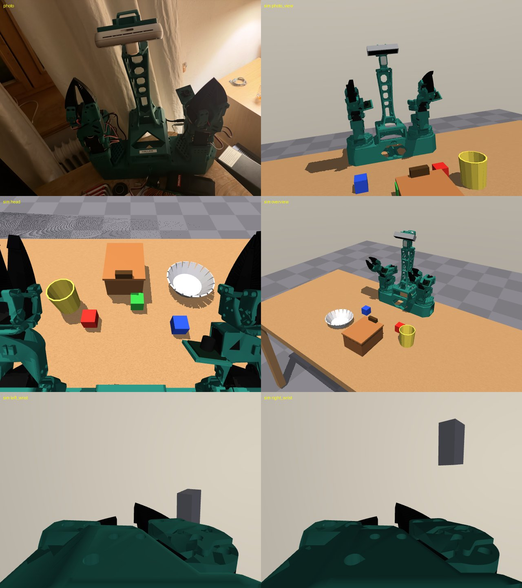
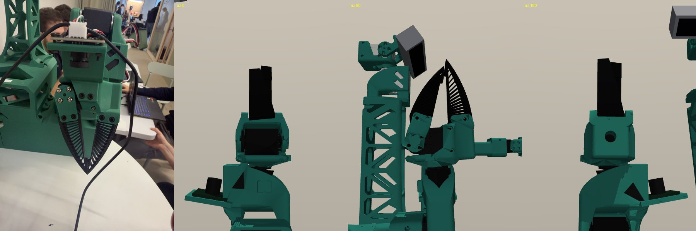

# ws4/sim: MuJoCo simulation of Oscar's XLeRobot station

## Status report (2026-10-17, ws4-sim)

**Done**
- `xlerobot_station.xml`: XLeRobot 0.4.0 torso (arm-base boxes, turntables, centre shell) on a table, octagon-hole
  neck with fixed head (mock servos) and a RealSense D455, two SO-101 arms with `left_`/`right_` joints and
  actuators, Oscar's actual soft gripper (XLeRobot `SO101_soft_fin.stl`: green PLA jaws + 67 mm TPU fins), wrist
  cameras, `left_ee`/`right_ee` TCP sites. All geometry comes from upstream CAD, not from guesses (see table below).
- `station_geometry.yaml`: single source of truth (arm base poses, TCP, cameras, intrinsics, gripper numbers, LeRobot
  unit conventions), each value flagged `verified: true/false`. The MJCF is generated from it (`build_model.py`).
- `env.py`: `XLeRobotStationEnv` with LeRobot-style keys, actions in LeRobot SO-101 calibrated units (degrees,
  gripper 0..100, or range_m100_100), per-arm FLUX view helper, EE poses, ground-truth object poses, domain
  randomisation (prop pose, colour, lighting, camera extrinsics and fov).
- Scenes with cubes, cup, bowl, hinged-lid box, obstacle in front of a target.
- Scripted IK pick: both arms grasp and lift a 4 cm cube (11.5 of 12 cm) and the cup (9.9 cm).
- Speed: one 30 Hz step with three 640x480 cameras plus depth takes ~19 ms (EGL, this laptop); physics alone
  ~5 ms per step (about 7x real time).
- 26 pytest tests pass on CPU/headless in ~3 s; `ruff check ws4/sim` is clean.

**Verified** (by Oscar or against upstream source/CAD): head camera is a D455 on a fixed mount; the label side of
the torso faces the workspace; both arms reach straight forward at the LeRobot calibration middle; gripper design and
fin dimensions (Oscar's close-up matches `SO101_soft_fin.stl`; the printed jaws register onto the stock SO-101 jaws
within 0.29 to 0.36 mm); LeRobot 0.5.1 unit formulas (read from source, tested against copies of them).

**Not verified on hardware**: exact arm mount position on the turntables, head camera pose/intrinsics, wrist camera
pose and lens model, joint signs and calibration midpoints, gripper closed/open angles, all dynamics and contact
parameters, table size.

**Next 3 steps**
1. On the robot: set the D455 to 55 deg down (the value in the yaml), put both arms at LeRobot 0 deg, grab one frame per
   camera and compare with `render_compare.py --pose zero`; fix camera poses in the yaml.
2. Save both arms' LeRobot calibration JSONs and jog each joint +20 deg once: confirms signs, gives exact
   range_m100_100 scaling (`XLeRobotStationEnv(calibration=...)`), and the real gripper closed/open range.
3. Use the env for FLUX: `env.arm_view(side)` gives the SO-101 checkpoint inputs per arm; scripted picks can
   generate sim demos for ws4-datasets.




## Run

```bash
python ws4/sim/view.py                                     # interactive viewer, robot on the table
python ws4/sim/view.py --scene ws4/sim/scenes/tabletop_props.xml --randomize --seed 3
MUJOCO_GL=egl python ws4/sim/render_compare.py             # PNGs + compare.png in ws4/sim/outputs/
MUJOCO_GL=egl python ws4/sim/scripted_pick.py --object cube_red --side left
python -m pytest ws4/sim/tests -q
python ws4/sim/build_model.py                              # regenerate MJCF after editing station_geometry.yaml
```

Headless rendering uses `MUJOCO_GL=egl` (the env sets it if unset). On a machine without a GPU use
`MUJOCO_GL=osmesa`; rendering tests skip when no GL backend works.

## Files

| Path | What |
|---|---|
| `station_geometry.yaml` | Source of truth. Edit values here, then run `build_model.py`. The `derived:` block at the end is generated. |
| `build_model.py` | Generates `model/station_robot.xml` (include), `xlerobot_station.xml`, `scenes/*.xml`. |
| `xlerobot_station.xml` | Robot on the table, no props. |
| `scenes/tabletop_props.xml` | All props (default for the env). Also `grasp_test`, `obstacle_target`, `lid_box`. |
| `env.py` | `XLeRobotStationEnv`. |
| `units.py` | LeRobot units to MJCF radians, per joint. |
| `geometry.py` | yaml loader, camera pose helpers (numpy only). |
| `ik.py`, `scripted_pick.py` | Small DLS IK and the scripted pick used by the grasp test. |
| `view.py`, `render_compare.py` | Viewer and render/compare tool. |
| `tools/prepare_assets.py` | Offline CAD to mesh pipeline (gmsh, trimesh in a throwaway venv). |
| `reference/` | Oscar's gripper close-up and the comparison images. |
| `../assets/so101`, `../assets/xlerobot_040` | Meshes (Apache-2.0, see NOTICE.md in each). |

## Frames and names

- World = torso frame: origin on the table top under the centre of the arm-base box, +x forward (toward the
  workspace, the side with the HALLER label), +y to the robot's left, +z up.
- Arm base frame = SO-101 `base` body of `so101_new_calib` (SO-ARM100). Left base at (-0.0216, +0.1366, 0.0850),
  right at (-0.0216, -0.1366, 0.0850), both yaw 0. At q = 0 each arm reaches along +x.
- `<side>_gripper` body: +z is the wrist_roll axis, fins point along -z, the moving jaw opens toward +x.
  TCP site `<side>_ee` at (-0.0019, 0, -0.0908) in that frame: between the two fin edges, 15 mm above the tips.
- Joints/actuators: `<side>_{shoulder_pan, shoulder_lift, elbow_flex, wrist_flex, wrist_roll, gripper}`.
  Cameras: `head`, `left_wrist`, `right_wrist` (plus `photo_view`, `overview`, `top_down` in scenes).

## Python API

```python
from ws4.sim.env import XLeRobotStationEnv
env = XLeRobotStationEnv(scene=None, units="degrees", calibration=None, depth=False, randomize=True)
obs, info = env.reset(seed=0)
obs["observation.state"]              # float32 (12,) [left 6 | right 6], LeRobot units
obs["observation.images.head"]        # uint8 (480, 640, 3); also left_wrist, right_wrist
obs["observation.images.head_depth"]  # uint16 mm (480, 640, 1) when depth=True (aligned to colour)
obs["privileged"]                     # object_poses {name: [x y z qw qx qy qz]}, ee_poses, qpos_rad, lid_angle
obs, reward, terminated, truncated, info = env.step(action12)   # absolute targets, LeRobot units, 30 Hz
env.arm_view("left")                  # {"scene": head img, "wrist": left_wrist img, "state": 6-D} for FLUX SO-101
env.ee_pose("right")                  # (pos, quat wxyz) of right_ee
```

`privileged` is ground truth for success checks and must not be fed to a policy.

## LeRobot units (units.py)

Read from lerobot 0.5.1 source: `so_follower` uses DEGREES for the five body joints by default (`use_degrees=True`
since v0.4.4), XLeRobot's plugin defaults to RANGE_M100_100, the gripper is always RANGE_0_100. DEGREES = (raw - mid)
x 360/4095 with mid the middle of the range recorded at calibration, so 0 deg is mid-range, which is also the
`so101_new_calib` MJCF zero; LeRobot's own kinematics feeds these degrees through `np.deg2rad` into that model. So per
body joint q_rad = sign x deg2rad(deg x 4095/4096) + offset with sign +1, offset 0 (both `verified: false` until a jog
test). RANGE_M100_100 needs each joint's recorded range: pass the LeRobot calibration JSON (`calibration={"left":
path, "right": path}`); without it the MJCF range is assumed. Gripper: 0 = fins touching (q = -0.2686 rad), 100 = open
(1.745 rad), linear. The FLUX SO-101 checkpoint expects degrees and a 0..100 gripper (BFL docs, flux3_action_so101).

## Parameters: verified vs approximated

| Parameter | Value | Status | Source |
|---|---|---|---|
| Torso, arm bases, turntables, centre shell | CAD meshes | from CAD, assembly matches photo | XLeRobot `XLeRobot040_armbase.step` |
| Neck and head (octagon neck, mock servos) | CAD meshes | from CAD, matches photo | XLeRobot `Assembly_RGBD_Gimbal.step` |
| Arm base positions | (-0.0216, +-0.1366, 0.085) | approximated (SO-101 base centred on turntable) | CAD turntable centres |
| Arm base yaw | 0 (forward) | verified | Oscar |
| SO-101 kinematics, inertias, joint ranges | so101_new_calib | from upstream model | SO-ARM100 `so101_new_calib.xml` |
| Gripper jaws and fins | SO101_soft_fin.stl | verified (Oscar's close-up), jaws registered to 0.3 mm | XLeRobot hardware |
| Fin insertion into jaw clamp | 9 mm | approximated | photo |
| Gripper closed angle | -0.2686 rad (fins touch) | computed from meshes | `test_fins_touch_at_closed_angle` |
| Gripper lower limit | -0.30 rad (stock -0.1745) | extended so fins can close | above |
| TCP | (-0.0019, 0, -0.0908) in gripper | approximated definition | yaml `tcp` |
| Joint damping/friction/armature | 0.60 / 0.052 / 0.028 | from upstream model (Open Duck Mini id) | SO-ARM100 `joints_properties` |
| Actuator kp / kv | 998.22 / 2.731 | from upstream model (RBE501 servo model, P gain 16) | SO-ARM100 MJCF comment |
| Torque limit | 2.94 N m (STS3215 12 V, 30 kg cm) | datasheet value | XLeRobot BOM (12 V servos) |
| Gripper torque limit | 1.47 N m | from LeRobot (50 % Max_Torque_Limit) | lerobot 0.5.1 `so_follower.py:166` |
| Head camera | D455, fixed, pos (0.034, 0.001, 0.442), 55 deg down | model verified; pose approximated; tilt chosen, Oscar sets it on hardware | gimbal CAD |
| Head fovy / intrinsics | 64 deg, fx = fy = 384 at 640x480 | approximated (datasheet 90 x 65 deg RGB) | Intel D400 datasheet |
| Wrist cameras | OV2710 100 deg, pos (0, 0.045, 0.015), 10 deg toward fins | model verified; pose estimated from photo | Oscar's close-up |
| Wrist fovy | 71 deg (100 deg assumed diagonal), no distortion | approximated | module listing |
| Fin contact | hull, solref 0.012, solimp 0.90/0.97/0.004, friction 1.2 | tuned in sim | grasp tests |
| Table | 1.6 x 0.8 m, robot at back edge | guess | Oscar does not know yet |
| PLA colour | rgb (0.13, 0.45, 0.40) | sampled from photo, white balanced | photo |

## Compliance model

The TPU fins are rigid convex hulls with soft contacts (a few mm of give), high friction and elliptic cones.
No flexcomp, so it stays well above real time. It holds 40 g cubes and the 50 g cup. It does not reproduce fin-ray
wrapping or the force-dependent contact area; if grasp fidelity matters, the next step is 3 to 4 passive hinge
segments per fin with springs fitted to a push test on the real fin.

## Open questions

1. Where exactly does each SO-101 base sit on its turntable (pan axis offset from the turntable centre)?
2. Real gripper closed/open angles in LeRobot calibration terms, and the fin clamp depth.
3. Wrist camera: exact pose on the gripper face, whether "100 deg" is diagonal or horizontal, distortion
   (checkerboard calibration with OpenCV would settle it).
4. D455: colour intrinsics at 640x480 (`rs-enumerate-devices -c`) and the lateral offset of the RGB sensor.
5. Which driver Oscar will run: LeRobot `bi_so_follower` (degrees) or XLeRobot's plugin (range_m100_100 by default).
6. The head device in `xlerobot_station.jpg` is white with a slider and vents, unlike a D455; worth a glance.

## Licences

- SO-101 model and meshes: TheRobotStudio SO-ARM100, Apache-2.0 (`ws4/assets/so101/LICENSE`).
- XLeRobot CAD (torso, neck, head, soft gripper): Vector-Wangel/XLeRobot, Apache-2.0 (`ws4/assets/xlerobot_040/LICENSE`).
- The XLeRobot web-demo MJCF (Vector-Wangel/MuJoCo-GS-Web, MIT) was read for reference only; nothing copied.
- Code in this folder: the repo has no licence file yet (team decision); upstream notices above still apply to the meshes.
